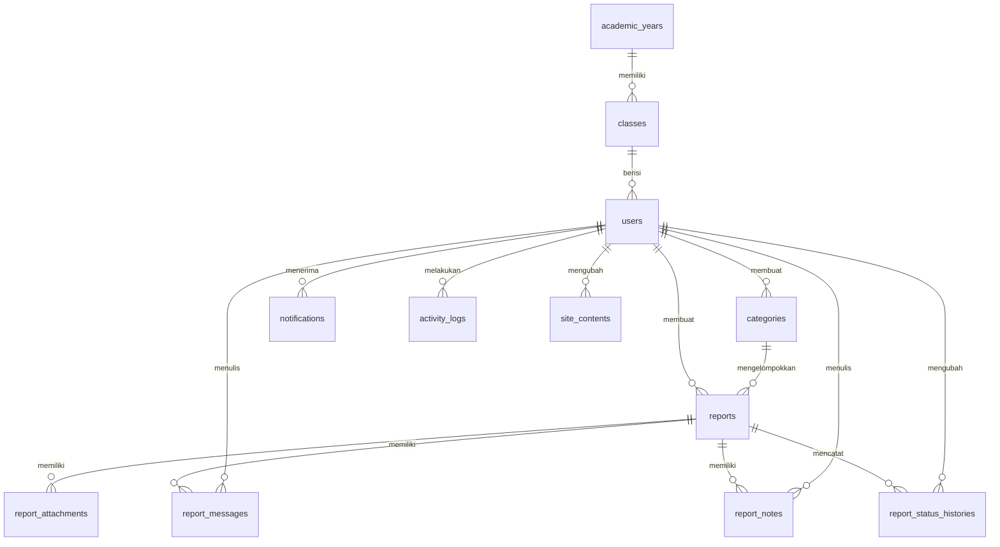

# Rancangan Database: SISPERKA

Diturunkan dari bagian *Model Data* di [`prd.md`](./prd.md). Database: **MySQL/MariaDB**, charset `utf8mb4`, engine InnoDB.

---

## 1. Prinsip Rancangan

1. **Laporan memakai UUID** sebagai primary key agar ID tidak bisa ditebak (mencegah IDOR).
2. **Kolom sensitif dienkripsi** di level aplikasi (cast `encrypted` Laravel). Kolom terenkripsi **tidak bisa dicari/difilter lewat SQL**, jadi pencarian dan filter hanya memakai kolom tidak terenkripsi (status, kategori, kelas, tanggal).
3. **Akun tidak dihapus permanen secara default.** Memakai `soft delete` (arsip) agar laporan lama tetap utuh.
4. **Snapshot kelas pada laporan.** Kelas siswa berubah tiap tahun ajaran (kenaikan kelas), sedangkan statistik per kelas harus mencerminkan kelas **saat laporan dibuat**. Karena itu laporan menyimpan nama kelas dan tingkat sebagai salinan.
5. **Tidak menyimpan IP atau user-agent pada laporan.** IP hanya ada di `activity_logs` (log keamanan akun).
6. **Riwayat bersifat append-only**: `report_status_histories` dan `activity_logs` hanya ditambah, tidak diubah atau dihapus lewat aplikasi.
7. **Tiga peran tetap** (`master`, `bk`, `siswa`) disimpan di kolom `role`. Paket Spatie Permission tidak diperlukan untuk versi 1.

---

## 2. Diagram Relasi (ERD)



---

## 3. Daftar Tabel

Tanda: 🔒 = terenkripsi · 🔑 = primary key · ⛓ = foreign key · ✦ = unique

### 3.1 `academic_years`
| Kolom | Tipe | Keterangan |
|---|---|---|
| 🔑 `id` | bigint unsigned | |
| `name` ✦ | varchar(20) | Mis. `2026/2027` |
| `is_active` | boolean, default false | Hanya satu yang aktif (dijaga di aplikasi) |
| `starts_on`, `ends_on` | date, nullable | |
| `created_at`, `updated_at` | timestamp | |

### 3.2 `classes`
| Kolom | Tipe | Keterangan |
|---|---|---|
| 🔑 `id` | bigint unsigned | |
| ⛓ `academic_year_id` | → `academic_years.id` | `restrict` |
| `name` | varchar(30) | Mis. `VII-A` |
| `grade_level` | tinyint | 7, 8, atau 9 |
| `created_at`, `updated_at` | timestamp | |

**Unik:** (`academic_year_id`, `name`)

### 3.3 `users`
| Kolom | Tipe | Keterangan |
|---|---|---|
| 🔑 `id` | bigint unsigned | |
| `role` | enum(`master`,`bk`,`siswa`) | Index |
| `login_id` ✦ | varchar(50) | **NIS** (siswa), **NIP/username** (bk), **username** (master) |
| `name` | varchar(100) | |
| `password` | varchar(255) | Hash bcrypt/argon2 |
| 🔒 `two_factor_secret` | text, nullable | Kunci rahasia TOTP (dienkripsi) untuk 2FA staf |
| 🔒 `two_factor_recovery_codes` | text, nullable | 8 kode pemulihan darurat 2FA (dienkripsi) |
| `two_factor_confirmed_at` | timestamp, nullable | Waktu verifikasi aktivasi 2FA |
| ⛓ `class_id` | → `classes.id`, nullable | Hanya untuk siswa; `nullOnDelete` |
| `gender` | enum(`L`,`P`), nullable | |
| `phone` | varchar(20), nullable | |
| `photo_path` | varchar(255), nullable | Foto profil (Guru BK) |
| `is_active` | boolean, default true | Akun nonaktif tidak bisa login |
| `must_change_password` | boolean, default true | Wajib ganti password |
| `last_login_at` | timestamp, nullable | |
| `locked_until` | timestamp, nullable | Penguncian sementara setelah gagal login berulang |
| `remember_token` | varchar(100), nullable | |
| `created_at`, `updated_at` | timestamp | |
| `deleted_at` | timestamp, nullable | **Soft delete = arsip** |

**Index:** `role`, `class_id`, `is_active`
**Catatan:**
- `login_id` unik **termasuk akun yang diarsipkan**, sehingga NIS tidak dipakai ulang secara tidak sengaja. NIS baru bisa dipakai lagi hanya setelah akun lama dihapus permanen.
- Tidak ada kolom email. Tidak ada tabel `password_reset_tokens`: reset password dilakukan oleh Master.

### 3.4 `categories`
| Kolom | Tipe | Keterangan |
|---|---|---|
| 🔑 `id` | bigint unsigned | |
| `name` ✦ | varchar(60) | Mis. `Perundungan Fisik` |
| `description` | varchar(255), nullable | |
| `is_active` | boolean, default true | Nonaktif = tidak muncul di form siswa |
| ⛓ `created_by` | → `users.id`, nullable | `nullOnDelete` |
| `created_at`, `updated_at` | timestamp | |

**Aturan:** kategori yang sudah dipakai laporan **tidak boleh dihapus**, hanya dinonaktifkan (`reports.category_id` memakai `restrict`).

**Data awal (seeder):** Fisik, Verbal, Siber (Cyberbullying), Sosial / Pengucilan, Lainnya.

### 3.5 `reports`
| Kolom | Tipe | Keterangan |
|---|---|---|
| 🔑 `id` | **uuid** | Primary key |
| ⛓ `reporter_id` | → `users.id`, **nullable** | `nullOnDelete`: jika akun dihapus permanen, laporan tetap ada dan pelapor menjadi anonim total |
| `is_hidden_identity` | boolean, default false | Jika true, tampil "Pelapor Rahasia" |
| `reporter_class_name` | varchar(30), nullable | Snapshot kelas saat melapor |
| `reporter_grade_level` | tinyint, nullable | Snapshot tingkat saat melapor |
| `reporter_role` | enum(`korban`,`saksi`) | |
| ⛓ `category_id` | → `categories.id` | `restrict` |
| `incident_date` | date | |
| `location` | varchar(150) | |
| 🔒 `description` | text | Kronologi |
| 🔒 `accused_name` | text, nullable | Nama terlapor |
| `urgency` | enum(`rendah`,`sedang`,`tinggi`), default `sedang` | Fitur P1; kolom disiapkan sejak awal |
| `status` | enum(`baru`,`diverifikasi`,`diproses`,`selesai`,`ditolak`), default `baru` | Index |
| `reject_reason` | text, nullable | Wajib saat status `ditolak` |
| `closed_at` | timestamp, nullable | Diisi saat `selesai`/`ditolak` |
| `created_at`, `updated_at` | timestamp | Index pada `created_at` |

**Index:** `status`, `category_id`, `reporter_id`, `created_at`, `reporter_class_name`, (`status`, `created_at`)
**Catatan:**
- **Tidak ada kolom IP/user-agent.**
- Jika `is_hidden_identity = true`, semua tampilan (kecuali aksi "Lihat identitas" milik Guru BK) memakai label "Pelapor Rahasia", termasuk pada ekspor.
- Statistik per kelas memakai `reporter_class_name` dan `reporter_grade_level`, bukan relasi ke tabel `classes` saat ini.

### 3.6 `report_attachments`
| Kolom | Tipe | Keterangan |
|---|---|---|
| 🔑 `id` | bigint unsigned | |
| ⛓ `report_id` | → `reports.id` (uuid) | `cascadeOnDelete` |
| `stored_name` ✦ | varchar(100) | Nama acak di disk (bukan nama asli) |
| `original_name` | varchar(255) | Nama asli yang sudah dibersihkan, hanya untuk tampilan |
| `mime_type` | varchar(100) | Hasil deteksi server, bukan dari klien |
| `size_bytes` | unsigned int | Maks. 5 MB |
| `created_at` | timestamp | |

**Batas aplikasi:** maks. 3 file per laporan. Penyimpanan di disk privat (`storage/app/private`), **bukan** folder `public`.

### 3.7 `report_messages` (balasan per laporan)
| Kolom | Tipe | Keterangan |
|---|---|---|
| 🔑 `id` | bigint unsigned | |
| ⛓ `report_id` | → `reports.id` | `cascadeOnDelete` |
| ⛓ `sender_id` | → `users.id`, nullable | `nullOnDelete` |
| `sender_role` | enum(`bk`,`siswa`) | |
| 🔒 `message` | text | |
| `created_at`, `updated_at` | timestamp | |

**Index:** (`report_id`, `created_at`)

### 3.8 `report_notes` (catatan internal Guru BK)
| Kolom | Tipe | Keterangan |
|---|---|---|
| 🔑 `id` | bigint unsigned | |
| ⛓ `report_id` | → `reports.id` | `cascadeOnDelete` |
| ⛓ `user_id` | → `users.id`, nullable | `nullOnDelete` |
| 🔒 `note` | text | **Tidak pernah ditampilkan ke siswa** |
| `created_at`, `updated_at` | timestamp | |

### 3.9 `report_status_histories` (append-only)
| Kolom | Tipe | Keterangan |
|---|---|---|
| 🔑 `id` | bigint unsigned | |
| ⛓ `report_id` | → `reports.id` | `cascadeOnDelete` |
| `from_status` | varchar(20), nullable | Null saat laporan pertama dibuat |
| `to_status` | varchar(20) | |
| ⛓ `changed_by` | → `users.id`, nullable | `nullOnDelete` |
| `reason` | text, nullable | Wajib saat `ditolak` |
| `created_at` | timestamp | Tidak ada `updated_at` |

**Index:** (`report_id`, `created_at`)

### 3.10 `notifications`
| Kolom | Tipe | Keterangan |
|---|---|---|
| 🔑 `id` | bigint unsigned | |
| ⛓ `user_id` | → `users.id` | `cascadeOnDelete` |
| `type` | varchar(40) | `report_new`, `report_status`, `report_reply`, `report_followup` |
| `title` | varchar(100) | Singkat, tanpa detail sensitif |
| `body` | varchar(255), nullable | Singkat, tanpa detail sensitif |
| `report_id` | uuid, nullable | Tautan ke laporan (otorisasi tetap dicek saat dibuka) |
| `read_at` | timestamp, nullable | |
| `created_at` | timestamp | |

**Index:** (`user_id`, `read_at`), (`user_id`, `created_at`)
**Aturan:** isi notifikasi **tidak boleh memuat kronologi, nama terlapor, atau nama pelapor rahasia**.

### 3.11 `activity_logs` (append-only)
| Kolom | Tipe | Keterangan |
|---|---|---|
| 🔑 `id` | bigint unsigned | |
| ⛓ `user_id` | → `users.id`, nullable | `nullOnDelete`; null untuk percobaan login gagal |
| `action` | varchar(60) | Lihat daftar aksi di bawah |
| `subject_type` | varchar(60), nullable | Mis. `report`, `user`, `import` |
| `subject_id` | varchar(40), nullable | String agar muat UUID |
| `description` | varchar(255), nullable | Tanpa data sensitif |
| `ip_address` | varchar(45), nullable | **Hanya log keamanan akun** |
| `created_at` | timestamp | Index |

**Index:** `user_id`, `action`, `created_at`, (`subject_type`, `subject_id`)

**Aksi yang wajib dicatat:**
`login_success`, `login_failed`, `logout`, `password_changed`, `password_reset`,
`identity_revealed` (Guru BK membuka identitas pelapor), `report_status_changed`, `report_downloaded`,
`user_created`, `user_updated`, `user_deactivated`, `user_archived`, `user_deleted_permanently`,
`class_users_archived`, `class_promoted`, `excel_imported`, `credentials_exported`.

> Log tidak boleh memuat isi laporan, nama terlapor, atau password. Aplikasi **tidak menyediakan** fitur ubah/hapus log.

### 3.12 `site_contents`
| Kolom | Tipe | Keterangan |
|---|---|---|
| 🔑 `id` | bigint unsigned | |
| `key` ✦ | varchar(60) | Mis. `school_name`, `school_address`, `school_phone`, `bk_hours`, `faq`, `about` |
| `value` | text / json | |
| ⛓ `updated_by` | → `users.id`, nullable | `nullOnDelete` |
| `created_at`, `updated_at` | timestamp | |

### 3.13 `periodic_report_summaries` (agregat otomatis bulanan/semesteran)
| Kolom | Tipe | Keterangan |
|---|---|---|
| 🔑 `id` | bigint unsigned | Primary key |
| `period_type` | enum(`monthly`,`semester`) | Index |
| `period_label` | varchar(100) | Mis. `Oktober 2026`, `Semester Ganjil 2026/2027` |
| `start_date`, `end_date` | date | Batang periode (Index) |
| `total_reports` | unsigned int, default 0 | Total laporan masuk pada periode |
| `new_reports`, `in_process_reports` | unsigned int, default 0 | Rincian status berjalan |
| `resolved_reports`, `rejected_reports` | unsigned int, default 0 | Rincian status selesai/ditolak |
| `urgent_high_reports`, `urgent_medium_reports`, `urgent_low_reports` | unsigned int, default 0 | Rincian tingkat urgensi |
| `categories_breakdown` | json, nullable | Agregasi jumlah kasus per kategori |
| `classes_breakdown` | json, nullable | Agregasi jumlah kasus per kelas/tingkat |
| `avg_resolution_days` | decimal(5,2), nullable | Rata-rata durasi penanganan (hari) |
| `generated_at` | timestamp | Waktu kompilasi agregat otomatis |
| `created_at`, `updated_at` | timestamp | |

**Unik:** (`period_type`, `period_label`)  
**Catatan Keamanan:** Agregat periodik **hanya menyimpan angka rekapitulasi statistik anonim**, sama sekali tidak memuat identitas pelapor, terlapor, maupun kronologi kasus.

### 3.14 Tabel bawaan Laravel
`sessions` (driver `database`), `cache`, `cache_locks`, `jobs`, `failed_jobs`, `migrations`.
Tidak dibutuhkan: `password_reset_tokens`.

---

## 4. Perilaku Saat Data Dihapus

| Aksi | Efek pada data |
|---|---|
| **Nonaktifkan** akun | `is_active = false`; tidak bisa login; semua data utuh |
| **Arsipkan** akun (hapus biasa) | Isi `deleted_at`; laporan utuh; pelapor tampil sebagai "Akun diarsipkan" |
| **Hapus permanen** akun (konfirmasi password Master) | Baris `users` dihapus; `reports.reporter_id` menjadi `NULL`; laporan, bukti, dan riwayat **tetap ada**, pelapor tampil sebagai "Pelapor tidak diketahui" |
| **Hapus akun per kelas** | Diarsipkan secara massal; dicatat di log (`class_users_archived`) |
| **Kenaikan kelas** | `users.class_id` berubah; laporan lama **tidak berubah** (snapshot kelas tetap) |
| **Nonaktifkan kategori** | `is_active = false`; laporan lama tetap menampilkan kategorinya |
| **Hapus kategori** | **Ditolak** bila sudah dipakai laporan |
| **Hapus laporan** | **Tidak ada fitur ini** pada versi 1 |

---

## 5. Urutan Migrasi

1. `academic_years` & `classes`
2. `users` (menyesuaikan migrasi bawaan Laravel; hilangkan email dan `password_reset_tokens`)
3. `sessions`, `cache`, `jobs` (bawaan)
4. `activity_logs`
5. `categories`
6. `reports`
7. `report_attachments`, `report_messages`, `report_notes`, `report_status_histories`
8. `notifications`
9. `settings` (`site_contents`)
10. `add_two_factor_columns_to_users_table` (Fase 10 - 2FA)
11. `periodic_report_summaries` (Fase 10 - Laporan Periodik Otomatis)

## 6. Seeder Awal

| Seeder | Isi |
|---|---|
| `AcademicYearSeeder` | Tahun ajaran aktif saat ini |
| `ClassSeeder` | Kelas VII–IX (contoh: VII-A, VII-B, VIII-A, ...) |
| `CategorySeeder` | Lima kategori awal |
| `SiteContentSeeder` | Teks beranda, tata cara, FAQ, info sekolah (dapat diubah Master) |
| `MasterSeeder` | **Minimal 2 akun Master**; password diambil dari `.env` atau prompt, **tidak ditulis di kode** |
| `DemoSeeder` (hanya lokal) | Siswa, Guru BK, dan laporan **palsu** untuk pengembangan |

---

## 7. Catatan Implementasi Laravel

```php
// Model Report
use Illuminate\Database\Eloquent\Concerns\HasUuids;

class Report extends Model
{
    use HasUuids;

    protected function casts(): array
    {
        return [
            'description'        => 'encrypted',
            'accused_name'       => 'encrypted',
            'is_hidden_identity' => 'boolean',
            'incident_date'      => 'date',
            'closed_at'          => 'datetime',
        ];
    }
}
// Model ReportMessage: 'message' => 'encrypted'
// Model ReportNote:    'note'    => 'encrypted'
// Model User: tambahkan SoftDeletes; 'password' => 'hashed'
```

- Migrasi `reports`: `$table->uuid('id')->primary();` dan kolom `description`/`accused_name` bertipe `text`.
- Kolom `report_id` di tabel anak: `$table->foreignUuid('report_id')->constrained()->cascadeOnDelete();`
- **Simpan `APP_KEY` dengan aman dan cadangkan terpisah dari backup database.** Tanpa `APP_KEY` yang sama, data terenkripsi **tidak bisa dibaca lagi**. Jangan pernah mengganti `APP_KEY` di produksi tanpa prosedur rotasi.
- Pencarian teks pada kronologi **tidak tersedia** (kolom terenkripsi). Pencarian daftar laporan hanya lewat status, kategori, kelas, tanggal, dan urgensi.
- Pakai **Policy** untuk `Report`: siswa hanya `view` bila `reporter_id == auth()->id()`; `bk` boleh semua; `master` **tidak boleh** `view`.

## 8. Retensi dan Pencadangan

- **Backup database harian**, dienkripsi, disimpan minimal 14 hari. Backup folder bukti (`storage/app/private`) dengan jadwal yang sama.
- **Simpan `APP_KEY` secara terpisah** (di tempat aman, bukan di repositori).
- Usulan retensi laporan: **5 tahun**, lalu diarsipkan/dihapus sesuai kebijakan sekolah (lihat pertanyaan terbuka di PRD).
- Uji pemulihan backup minimal satu kali sebelum peluncuran.

## 9. Pertanyaan Terbuka

- [ ] Apakah satu siswa boleh memiliki beberapa laporan aktif pada saat yang sama? (Rancangan saat ini: boleh.)
- [ ] Apakah perlu batas jumlah laporan per hari per siswa untuk mencegah spam? (Saran: ya, via rate limiting.)
- [ ] Kebijakan retensi final: berapa lama laporan disimpan?