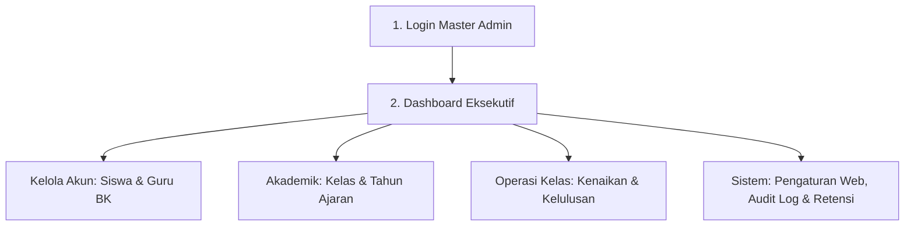
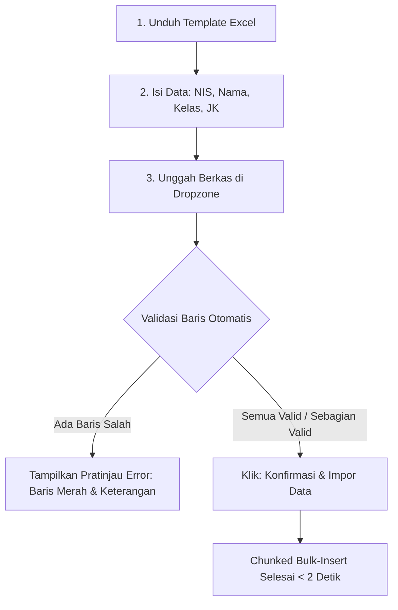
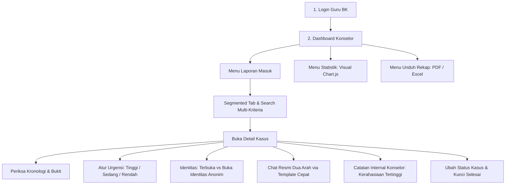
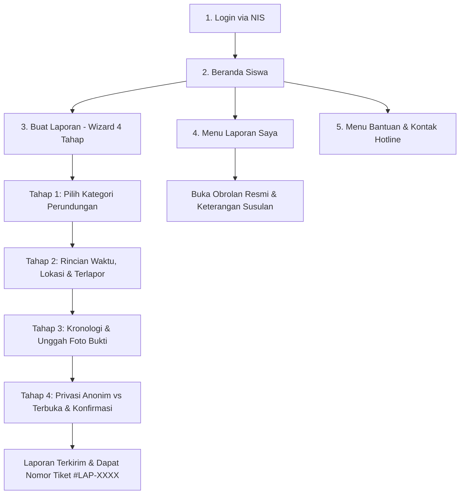
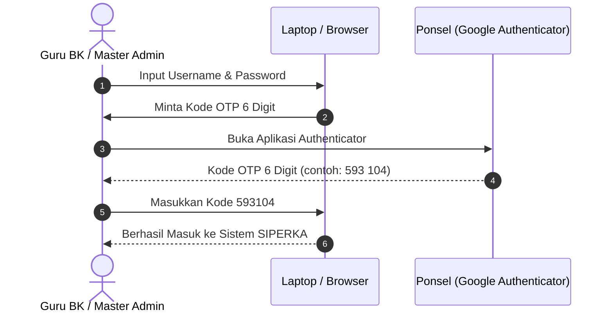

# BUKU PANDUAN TATA CARA PENGGUNAAN SISTEM INFORMASI SIPERKA
## *Sistem Pelaporan Perundungan MTs Soebono Mantofani*
### **Buku Panduan Operasional Lengkap untuk Master Admin, Guru BK, dan Siswa**

---

```
================================================================================
                    PANDUAN OPERASIONAL & TATA CARA LENGKAP
                       APLIKASI WEB SIPERKA (EDISI 2026)
================================================================================
Aplikasi      : SIPERKA (Sistem Pelaporan Perundungan)
Institusi     : MTs Soebono Mantofani, Jombang - Ciputat, Tangerang Selatan
Urutan Panduan: 1. Master Admin  |  2. Guru BK  |  3. Siswa (Peserta Didik)
Fokus Buku    : Prosedur Langkah-demi-Langkah, Penjelasan Fitur & Variasi Kemungkinan
================================================================================
```

---

## DAFTAR ISI PANDUAN

- [RINGKASAN PERAN PENGGUNA & KREDENSIAL AWAL](#ringkasan-peran-pengguna--kredensial-awal)
- [BAGIAN 1: TATA CARA PENGGUNAAN MASTER ADMIN](#bagian-1-tata-cara-penggunaan-master-admin)
  - [1.1 Cara Masuk (Login) Akun Master Admin](#11-cara-masuk-login-akun-master-admin)
  - [1.2 Memahami Dashboard Eksekutif](#12-memahami-dashboard-eksekutif)
  - [1.3 Kelola Akun Siswa (Manual, Edit, Reset Password, Hapus)](#13-kelola-akun-siswa-manual-edit-reset-password-hapus)
  - [1.4 Kelola Akun Guru BK (Manual, Edit, Reset Password, Hapus)](#14-kelola-akun-guru-bk-manual-edit-reset-password-hapus)
  - [1.5 Impor Data Siswa Massal via Excel](#15-impor-data-siswa-massal-via-excel)
  - [1.6 Kelola Data Kelas & Tahun Ajaran](#16-kelola-data-kelas--tahun-ajaran)
  - [1.7 Operasi Kenaikan Kelas & Kelulusan / Pengarsipan Alumni](#17-operasi-kenaikan-kelas--kelulusan--pengarsipan-alumni)
  - [1.8 Pengaturan Identitas Web Madrasah & Beranda](#18-pengaturan-identitas-web-madrasah--beranda)
  - [1.9 Memantau Log Audit Aktivitas Keamanan](#19-memantau-log-audit-aktivitas-keamanan)
  - [1.10 Evaluasi & Kebijakan Retensi Data](#110-evaluasi--kebijakan-retensi-data)
  - [1.11 Profil Master & Keamanan Akun](#111-profil-master--keamanan-akun)
- [BAGIAN 2: TATA CARA PENGGUNAAN GURU BK (KONSELOR)](#bagian-2-tata-cara-penggunaan-guru-bk-konselor)
  - [2.1 Cara Masuk (Login) Akun Guru BK](#21-cara-masuk-login-akun-guru-bk)
  - [2.2 Memahami Dashboard Konselor & Kartu Kasus Urgensi Tinggi](#22-memahami-dashboard-konselor--kartu-kasus-urgensi-tinggi)
  - [2.3 Daftar Laporan Masuk, Filter Segmented Tab, Pencarian & Sortir](#23-daftar-laporan-masuk-filter-segmented-tab-pencarian--sortir)
  - [2.4 Memeriksa Detail Kasus, Kronologi & Bukti Lampiran](#24-memeriksa-detail-kasus-kronologi--bukti-lampiran)
  - [2.5 Mengelola Tingkat Urgensi Kasus (Tinggi, Sedang, Rendah)](#25-mengelola-tingkat-urgensi-kasus-tinggi-sedang-rendah)
  - [2.6 Prosedur Membuka Identitas Pelapor Rahasia (Anonim)](#26-prosedur-membuka-identitas-pelapor-rahasia-anonim)
  - [2.7 Komunikasi Obrolan Resmi dengan Siswa & Template Cepat](#27-komunikasi-obrolan-resmi-dengan-siswa--template-cepat)
  - [2.8 Menulis & Mengelola Catatan Internal Guru BK (Kerahasiaan Tertinggi)](#28-menulis--mengelola-catatan-internal-guru-bk-kerahasiaan-tertinggi)
  - [2.9 Memperbarui Status Laporan & Penutupan Kasus Permanen](#29-memperbarui-status-laporan--penutupan-kasus-permanen)
  - [2.10 Mengelola Kategori Perundungan](#210-mengelola-kategori-perundungan)
  - [2.11 Membaca Analisis Statistik Grafik Interaktif](#211-membaca-analisis-statistik-grafik-interaktif)
  - [2.12 Mengunduh Rekapitulasi Laporan (Format PDF & Excel)](#212-mengunduh-rekapitulasi-laporan-format-pdf--excel)
  - [2.13 Pengelolaan Laporan Periodik Otomatis (Bulanan & Semesteran)](#213-pengelolaan-laporan-periodik-otomatis-bulanan--semesteran)
  - [2.14 Pusat Notifikasi Guru BK](#214-pusat-notifikasi-guru-bk)
  - [2.15 Profil Guru BK & Pengaturan Sandi](#215-profil-guru-bk--pengaturan-sandi)
- [BAGIAN 3: TATA CARA PENGGUNAAN SISWA (PESERTA DIDIK)](#bagian-3-tata-cara-penggunaan-siswa-peserta-didik)
  - [3.1 Cara Masuk (Login) Akun Siswa](#31-cara-masuk-login-akun-siswa)
  - [3.2 Memahami Beranda Siswa](#32-memahami-beranda-siswa)
  - [3.3 Tata Cara Membuat Laporan (Wizard Formulir 4 Langkah)](#33-tata-cara-membuat-laporan-wizard-formulir-4-langkah)
  - [3.4 Memantau Status Laporan & Membuka Riwayat Kasus](#34-memantau-status-laporan--membuka-riwayat-kasus)
  - [3.5 Berinteraksi di Ruang Percakapan Resmi & Mengirim Bukti Susulan](#35-berinteraksi-di-ruang-percakapan-resmi--mengirim-bukti-susulan)
  - [3.6 Mengakses Pusat Bantuan & Hotline Kontak Darurat](#36-mengakses-pusat-bantuan--hotline-kontak-darurat)
  - [3.7 Membuka Notifikasi Pemberitahuan Siswa](#37-membuka-notifikasi-pemberitahuan-siswa)
  - [3.8 Mengubah Kata Sandi di Menu Profil Siswa](#38-mengubah-kata-sandi-di-menu-profil-siswa)
- [BAGIAN 4: PANDUAN PENGAMANAN AKUN STAF DENGAN 2FA TOTP](#bagian-4-panduan-pengamanan-akun-staf-dengan-2fa-totp)
  - [4.1 Cara Mengaktifkan 2FA Menggunakan Ponsel](#41-cara-mengaktifkan-2fa-menggunakan-ponsel)
  - [4.2 Penggunaan 8 Kode Pemulihan Darurat (Recovery Codes)](#42-penggunaan-8-kode-pemulihan-darurat-recovery-codes)
  - [4.3 Cara Menonaktifkan 2FA](#43-cara-menonaktifkan-2fa)
- [BAGIAN 5: TABEL LENGKAP VARIASI KEMUNGKINAN SKENARIO FITUR](#bagian-5-tabel-lengkap-variasi-kemungkinan-skenario-fitur)

---

## RINGKASAN PERAN PENGGUNA & KREDENSIAL AWAL

| Peran Pengguna | ID Masuk (*Login ID*) | Kata Sandi Bawaan | Wewenang Utama |
|---|---|---|---|
| **Master Admin** | Username Admin (contoh: `master1`) | Diberikan saat instalasi | Mengelola seluruh akun, data kelas, impor data, konfigurasi web, dan log audit keamanan. **Tidak dapat membaca isi kasus laporan.** |
| **Guru BK** | NIP / Username (contoh: `198501012010012001`) | `GuruBK123!` *(wajib ganti)* | Membaca kronologi, memeriksa bukti, mengklasifikasi urgensi, mediasi/chat resmi, membuat catatan internal, mengubah status, unduh rekap kasus. |
| **Siswa** | NIS Siswa (contoh: `20261001`) | `SiswaMTS!` | Melapor perundungan (terbuka/anonim), mengunggah foto bukti, memantau status, mengirim pesan balasan ke Guru BK. |

---

# BAGIAN 1: TATA CARA PENGGUNAAN MASTER ADMIN

Master Admin bertanggung jawab atas ketersediaan akun, kelancaran operasional kelas tahunan, dan pengawasan audit sistem.



---

### 1.1 Cara Masuk (Login) Akun Master Admin
1. Buka peramban dan akses alamat web SIPERKA.
2. Klik tombol **Masuk** di pojok kanan atas.
3. Masukkan **Username** dan **Kata Sandi** Master Admin.
4. Klik **Masuk ke Portal**.
5. *Kemungkinan yang terjadi*:
   - **Jika akun belum mengaktifkan 2FA**: Langsung diarahkan ke Dashboard Master.
   - **Jika akun sudah mengaktifkan 2FA**: Muncul form verifikasi 6 digit OTP. Buka aplikasi Google/Microsoft Authenticator di ponsel, masukkan kode OTP 6 digit, lalu tekan tombol verifikasi.
   - **Jika kata sandi salah**: Muncul pesan error merah *"Kredensial yang Anda masukkan tidak sesuai."* (Sistem membatasi percobaan gagal untuk mencegah serangan brute-force).

---

### 1.2 Memahami Dashboard Eksekutif
Dashboard Master Admin menyajikan ringkasan operasional sistem:
* **Kartu KPI Metrik**: Total Akun Siswa Aktif, Total Guru BK, Total Rombel Kelas, dan Total Tahun Ajaran.
* **Grafik Statistik Agregat Laporan**: Grafik agregat jumlah laporan per status murni tanpa rincian kronologi siswa (menjaga privasi).
* **Navigasi Sidebar Semantik**:
  - `Kelola Akun`: Submenu Data Siswa & Data Guru BK.
  - `Akademik & Kelas`: Submenu Data Kelas, Data Tahun Ajaran, dan Operasi Kelas.
  - `Sistem & Konfigurasi`: Submenu Log Aktivitas, Pengaturan Web, dan Evaluasi Retensi.

---

### 1.3 Kelola Akun Siswa (Manual, Edit, Reset Password, Hapus)
Menu ini digunakan untuk mengelola data akun peserta didik.

#### A. Menambah Siswa Baru Secara Manual
1. Masuk menu **Data Siswa** &rarr; klik tombol **Tambah Siswa**.
2. Masukkan data pada formulir:
   - **NIS**: Nomor Induk Siswa (wajib angka unik, contoh: `20261088`).
   - **Nama Lengkap**: Nama resmi siswa sesuai rapor.
   - **Kelas**: Pilih rombel kelas siswa dari dropdown.
   - **Jenis Kelamin**: Pilih Laki-laki (`L`) atau Perempuan (`P`).
   - **Kata Sandi**: Opsional (jika dikosongkan, otomatis menggunakan sandi standar `SiswaMTS!`).
3. Klik tombol **Simpan Akun Siswa**.
4. *Kemungkinan yang terjadi*:
   - **Jika Berhasil**: Muncul notifikasi toast SweetAlert2 hijau *"Akun siswa berhasil didaftarkan"*. Formulir otomatis bersih (*auto-reset*) sehingga admin dapat langsung mendaftarkan siswa berikutnya tanpa menekan tombol reset.
   - **Jika NIS Kembar**: Formulir menolak dan memunculkan pesan error *"NIS sudah terdaftar pada siswa lain."*

#### B. Mengubah Data Siswa (Edit)
1. Pada tabel siswa, gunakan kotak pencarian untuk mencari nama atau NIS siswa.
2. Klik tombol **Edit** (ikon pensil).
3. Ubah nama, rombel kelas, atau jenis kelamin.
4. Klik **Perbarui Data**.

#### C. Reset Password Siswa
Fitur ini digunakan jika siswa melapor bahwa ia lupa kata sandi akunnya:
1. Cari akun siswa pada tabel.
2. Klik tombol **Reset Password** (ikon kunci).
3. Muncul dialog konfirmasi **SweetAlert2**: *"Apakah Anda yakin ingin mengatur ulang kata sandi siswa ini ke default?"*
4. Klik tombol **Ya, Reset Sandi**.
5. *Kemungkinan*: Sandi siswa seketika kembali menjadi `SiswaMTS!`. Siswa dapat langsung login kembali menggunakan sandi default tersebut dan disarankan segera menggantinya di menu Profil Siswa.

#### D. Menghapus Akun Siswa
1. Klik tombol **Hapus** (ikon tempat sampah berwarna merah).
2. Muncul dialog konfirmasi bahaya SweetAlert2.
3. Klik **Ya, Hapus Akun**.
4. *Kemungkinan*: Data akun siswa dinonaktifkan.

---

### 1.4 Kelola Akun Guru BK (Manual, Edit, Reset Password, Hapus)
Menu ini digunakan untuk mendaftarkan staf konselor yang berhak menangani kasus perundungan.

1. Buka menu **Data Guru BK** &rarr; klik **Tambah Guru BK**.
2. Masukkan data: **NIP / Username**, **Nama Lengkap & Gelar**, **Email**, dan **Kata Sandi** (default: `GuruBK123!`).
3. Klik **Simpan Akun Guru BK**.
4. *Kemungkinan Fitur*:
   - Tombol **Reset Password Guru BK**: Mengembalikan kata sandi konselor ke sandi awal jika konselor lupa kata sandi dan terkunci dari sistem.
   - Tombol **Hapus Guru BK**: Menghapus hak akses staf konselor yang telah mutasi/berhenti bertugas.

---

### 1.5 Impor Data Siswa Massal via Excel
Fitur ini digunakan untuk memasukkan ratusan data siswa baru sekaligus pada tahun ajaran baru dalam hitungan detik.



#### Langkah Operasional Impor:
1. Buka menu **Data Siswa** &rarr; klik tombol **Impor Excel**.
2. Klik tautan **Unduh Format Template (.xlsx)**.
3. Buka file template di Microsoft Excel. Isi kolom secara presisi:
   - Kolom `nis`: Angka NIS unik.
   - Kolom `nama`: Nama lengkap siswa.
   - Kolom `kelas`: Nama kelas yang **sudah ada** di menu Data Kelas (contoh: `7-A`, `7-B`, `8-A`).
   - Kolom `jenis_kelamin`: Huruf `L` atau `P`.
4. Tarik (*drag-and-drop*) berkas Excel yang sudah diisi ke area kotak unggah (*Dropzone*), atau klik kotak untuk memilih file dari komputer.
5. Klik **Periksa & Verifikasi Berkas**.
6. *Kemungkinan yang terjadi pada Pratinjau*:
   - **Kemungkinan A (Semua Baris Valid)**: Muncul tabel hijau dengan tulisan *"X baris data valid dan siap diimpor"*. Klik tombol **Konfirmasi & Impor Seluruh Data**. Seluruh siswa akan tersimpan ke database dalam sekejap.
   - **Kemungkinan B (Ditemukan Baris Error)**: Sistem menampilkan daftar baris yang salah (misal: NIS sudah terpakai di baris 15, atau kelas `7-Z` tidak terdaftar di madrasah). Admin dapat memilih untuk membatalkan dan memperbaiki Excel, atau hanya mengimpor baris yang valid saja.

---

### 1.6 Kelola Data Kelas & Tahun Ajaran
1. **Menu Data Kelas**:
   - Klik **Tambah Kelas** untuk mendaftarkan rombel baru (contoh: Tingkat `7`, Nama Rombel `7-A`).
   - Admin dapat menetapkan nama wali kelas pada rombel tersebut.
2. **Menu Tahun Ajaran**:
   - Menambah tahun pelajaran baru (contoh: `2026/2027`).
   - Menetapkan status **Aktif** pada tahun ajaran yang sedang berjalan (hanya boleh ada 1 tahun ajaran aktif dalam satu waktu).

---

### 1.7 Operasi Kenaikan Kelas & Kelulusan / Pengarsipan Alumni
Fitur berkala yang dijalankan sekali setiap akhir tahun ajaran (bulan Juni/Juli).

#### A. Kenaikan Kelas Massal
1. Masuk menu **Operasi Kelas** &rarr; tab **Kenaikan Kelas**.
2. Pilih Kelas Asal (contoh: `7-A`) dan pilih Kelas Tujuan (contoh: `8-A`).
3. Sistem memunculkan daftar seluruh siswa di kelas tersebut dengan kotak centang (*checkbox*).
4. *Kemungkinan*:
   - Secara default, seluruh siswa tercentang (naik kelas).
   - Jika ada siswa yang **tinggal kelas**, hilangkan tanda centang pada nama siswa tersebut.
5. Klik tombol **Proses Kenaikan Kelas**. Seluruh rombel siswa akan berpindah ke tingkat berikutnya secara serentak.

#### B. Kelulusan & Pengarsipan Massal Siswa Alumni (Kelas 9)
1. Masuk menu **Operasi Kelas** &rarr; tab **Pengarsipan Alumni**.
2. Pilih rombel kelas 9 yang telah lulus ujian (contoh: `9-A`).
3. Klik tombol **Arsipkan Siswa Lulus**.
4. Konfirmasi dialog peringatan SweetAlert2.
5. *Kemungkinan & Mekanisme Khusus*:
   - Akun siswa kelas 9 yang diluluskan akan dinonaktifkan dari akses login.
   - **PRINSIP SOFT-DELETE**: Seluruh data riwayat laporan perundungan yang pernah dibuat atau melibatkan siswa tersebut di masa lalu **TIDAK AKAN DIHAPUS**. Data historis tetap tersimpan utuh di database madrasah untuk keperluan arsip hukum dan akreditasi madrasah aman.

---

### 1.8 Pengaturan Identitas Web Madrasah & Beranda
1. Buka menu **Pengaturan Web**.
2. Admin dapat mengubah informasi publik:
   - Nama Resmi Madrasah (*MTs Soebono Mantofani*).
   - Alamat Lengkap Kampus, Nomor Telepon Sekretariat, dan Email Resmi.
   - Lokasi Ruang BK dan Jam Layanan Konseling.
   - Teks Sambutan & Narasi Kampanye Madrasah Ramah Anak di halaman depan (*welcome page*).
3. Klik **Simpan Pengaturan Web**. Perubahan seketika tampil di halaman publik dan footer sistem.

---

### 1.9 Memantau Log Audit Aktivitas Keamanan
Menu ini berfungsi sebagai CCTV digital sistem (*append-only*, tidak dapat diubah atau dihapus oleh siapapun).

1. Buka menu **Log Aktivitas**.
2. Tabel mencatat setiap kejadian penting:
   - Waktu & Jam Kejadian (WIB).
   - Nama Pengguna & Peran (*Master Admin / Guru BK*).
   - Aksi yang Dilakukan (contoh: `Buka Identitas Pelapor Rahasia #LAP-0005`, `Hapus Siswa NIS 20261012`, `Impor 120 Siswa`).
   - Alamat IP Komputer & Jenis Peramban (*User Agent*).
3. Gunakan kotak filter pencarian untuk menelusuri aktivitas tertentu berdasarkan tanggal atau kata kunci.

---

### 1.10 Evaluasi & Kebijakan Retensi Data
1. Buka menu **Evaluasi Retensi**.
2. Fitur ini menampilkan daftar laporan yang telah berusia lebih dari batas retensi madrasah (misal: kasus berstatus selesai yang telah melampaui 3 atau 5 tahun).
3. Master Admin dapat meninjau kepatuhan pembersihan data sesuai pedoman retensi Kementerian Agama.

---

### 1.11 Profil Master & Keamanan Akun
1. Buka menu **Profil Saya** di pojok kanan atas.
2. Admin dapat memperbarui nama, email, dan kata sandi baru.
3. Mengaktifkan perlindungan login **2FA TOTP** (panduan lengkap di Bagian 4).

---

# BAGIAN 2: TATA CARA PENGGUNAAN GURU BK (KONSELOR)

Guru BK adalah garda terdepan dalam merespons pengaduan siswa, melakukan pendampingan, memediasi perselisihan, dan mendokumentasikan intervensi kasus.



---

### 2.1 Cara Masuk (Login) Akun Guru BK
1. Akses web SIPERKA &rarr; klik **Masuk**.
2. Masukkan **NIP atau Username** konselor dan **Kata Sandi**.
3. Klik **Masuk ke Portal**.
4. *Kemungkinan*: Jika 2FA aktif, masukkan 6 digit kode OTP dari ponsel Anda.

---

### 2.2 Memahami Dashboard Konselor & Kartu Kasus Urgensi Tinggi
Dashboard Guru BK dirancang untuk memprioritaskan penanganan kasus:
* **Kartu Kasus Berurgensi Tinggi (*Top Alert*)**: Terletak di baris paling atas dengan indikator merah berkedip (*animate-pulse*). Menampilkan laporan darurat yang wajib ditangani dalam waktu maksimal 1x24 jam kerja.
* **Metrik Kasus**:
  - *Total Laporan*: Seluruh laporan yang pernah diterima.
  - *Perlu Tindak Lanjut*: Laporan berstatus *Baru* yang menunggu dibaca dan diverifikasi.
  - *Sedang Ditangani*: Laporan berstatus *Diproses* yang sedang dalam tahap konseling aktif.
  - *Kasus Selesai*: Rekapitulasi kasus yang berhasil dituntaskan.
* **Tombol Cepat Buka Laporan**: Tombol langsung untuk menuju ke antrean laporan masuk.

---

### 2.3 Daftar Laporan Masuk, Filter Segmented Tab, Pencarian & Sortir
Menu ini adalah meja kerja utama konselor.

#### A. Segmented Tab Status Laporan
Di bagian atas terdapat tab status dengan dot warna dan hitungan counter:
* **Semua**: Menampilkan seluruh laporan tanpa filter status.
* **Diterima (Baru)** *(Dot Merah)*: Laporan yang baru saja dikirim oleh siswa.
* **Diverifikasi** *(Dot Biru)*: Laporan yang sudah dibaca konselor.
* **Dalam Penanganan** *(Dot Kuning/Amber)*: Kasus yang sedang dijadwalkan mediasi atau konseling.
* **Selesai** *(Dot Hijau)*: Kasus yang telah berdamai dan penanganan dinyatakan tuntas.
* **Ditolak** *(Dot Abu-abu)*: Laporan yang tidak memenuhi kriteria penanganan.

#### B. Kotak Pencarian Multi-Kriteria Cerdas
Guru BK dapat mencari laporan menggunakan berbagai kata kunci:
* Mengetik nomor tiket: `#LAP-0005` atau cukup angkanya `5`.
* Mengetik nama lokasi kejadian: `Kantin`, `Musholla`, `Grup WhatsApp`.
* Mengetik nama rombel: `8-B`, `9-A`.
* Mengetik peran: `Korban` atau `Saksi`.
* Mengetik nama atau NIS siswa pelapor non-anonim.
* *Kemungkinan Privasi*: Jika laporan berstatus anonim, nama siswa pelapor tidak akan pernah muncul pada hasil pencarian nama demi melindungi identitasnya.

#### C. Filter Tanggal & Pengurutan
* **Rentang Tanggal**: Masukkan tanggal awal (`date_from`) dan tanggal akhir (`date_to`) untuk menyaring kasus pada periode tertentu.
* **Urutan (*Sort*)**:
  - *Terbaru Masuk*: Laporan paling baru berada di baris teratas.
  - *Urgensi Tertinggi*: Laporan berkategori Urgensi Tinggi diprioritaskan di baris teratas.
* Tombol **Reset**: Mengembalikan seluruh filter ke kondisi semula.
* Tombol **Terapkan Filter**: Menjalankan kueri pencarian.

#### D. Tampilan Antarmuka Desktop vs Mode HP
* **Pada Layar Desktop**: Menampilkan tabel data lengkap dengan kolom ID, Waktu, Urgensi, Pelapor, Peran, Kelas, Kategori, Status, dan Tombol Aksi.
* **Pada Layar Ponsel (HP)**: Otomatis berubah menjadi daftar kartu modern yang rapi. Setiap kartu memuat nomor tiket, lencana status, pil urgensi, nama kategori tebal, nama pelapor/anonim, lokasi kejadian, dan ikon panah chevron yang mudah disentuh dengan jari.

---

### 2.4 Memeriksa Detail Kasus, Kronologi & Bukti Lampiran
Klik salah satu laporan untuk membuka lembar detail kasus:

1. **Rincian Fakta Kejadian**:
   - Tanggal & Waktu Kejadian.
   - Tempat / Lokasi Spesifik.
   - Pihak yang Terlapor (nama atau ciri-ciri siswa yang dilaporkan).
2. **Penjelasan Kronologi Lengkap**:
   - Teks kronologi yang dituliskan siswa ditampilkan dalam kotak bersih dengan format rata kanan-kiri (*text-justify*) dan pemecah baris rapi.
   - Teks pendek tidak akan terdorong ke tengah, sedangkan teks panjang tersusun rapi seperti paragraf buku.
3. **Pemeriksaan Bukti Lampiran**:
   - *Kemungkinan A (Ada Bukti)*: Muncul kartu berkas (foto memar, tangkapan layar chat, dokumen PDF) beserta nama file dan ukurannya. Klik tombol **Buka** untuk melihat berkas asli beresolusi penuh di tab baru.
   - *Kemungkinan B (Tanpa Bukti)*: Tampil kotak bergaris putus-putus dengan keterangan *"Tidak ada berkas lampiran yang disertakan pada laporan ini."* (Laporan tetap sah untuk ditindaklanjuti).

---

### 2.5 Mengelola Tingkat Urgensi Kasus (Tinggi, Sedang, Rendah)
Guru BK dapat menilai dan menetapkan skala prioritas penanganan kasus:
1. Temukan kartu **Tingkat Urgensi Kasus** di panel sebelah kanan.
2. Pilih derajat urgensi pada dropdown:
   - **Tinggi**: Ada indikasi kekerasan fisik berkelanjutan, luka fisik, pemerasan berulang, atau trauma psikologis berat.
   - **Sedang**: Intimidasi verbal terus-menerus, pengucilan sosial kelompok, atau teror digital.
   - **Rendah**: Perselisihan ejekan kecil spontan atau salah paham antarteman.
3. Klik **Simpan Tingkat Urgensi**.
4. *Kemungkinan*: Lencana urgensi pada kartu dan tabel laporan seketika berubah warna (Merah untuk Tinggi, Amber untuk Sedang, Abu-abu untuk Rendah).

---

### 2.6 Prosedur Membuka Identitas Pelapor Rahasia (Anonim)
Jika siswa memilih mode pelaporan rahasia, identitasnya akan disamarkan sebagai **Pelapor Rahasia**:
1. Guru BK hanya dapat melihat rombel kelas siswa (misal: `Kelas 8-B`) dan peran pelapor (`Korban`).
2. *Kapan Identitas Boleh Dibuka?*: Pembukaan identitas hanya diizinkan dalam kondisi mendesak (*emergency*), misalnya siswa berada dalam ancaman fisik nyata dan Guru BK harus segera menemui siswa tersebut secara langsung.
3. Klik tombol **Buka Identitas Pelapor**.
4. Muncul dialog konfirmasi hukum: *"Tindakan membuka identitas pelapor rahasia akan dicatat ke dalam log audit keamanan sistem. Apakah Anda yakin?"*
5. Klik **OK / Konfirmasi**.
6. *Kemungkinan*: Kotak identitas terbuka, menampilkan Nama Lengkap siswa, NIS, dan foto profil. Aksi pembukaan ini **seketika terekam ke Log Audit Master Admin** sebagai bukti integritas konselor.

---

### 2.7 Komunikasi Obrolan Resmi dengan Siswa & Template Cepat
Fitur ini adalah ruang percakapan dua arah antara Guru BK dan Siswa pelapor:
1. Buka kartu **Komunikasi Resmi dengan Siswa Pelapor**.
2. Perhatikan badge **Saluran Aktif** dan jumlah pesan yang telah bertukar.
3. Guru BK dapat mengetik pesan arahan secara manual atau menggunakan tombol **Template Respon Cepat Konselor**:
   - 💬 *Konfirmasi Diterima & Ditenangkan*: Memberikan rasa aman bahwa laporan sudah dibaca dan siswa tidak perlu takut lagi.
   - 📅 *Undangan ke Ruang BK*: Menjadwalkan jam konseling tatap muka secara santai saat istirahat sekolah.
   - 🔍 *Permintaan Keterangan Tambahan*: Meminta siswa menyebutkan saksi teman atau bukti pendukung lain.
   - ✅ *Pemantauan Pasca-Penanganan*: Memeriksa kondisi emosional siswa setelah mediasi kasus selesai.
4. Klik **Kirim Balasan Resmi**.
5. *Kemungkinan*: Pesan terkirim dalam gelembung obrolan hijau (kanan) dan siswa akan menerima notifikasi lonceng di ponsel/laptopnya secara seketika.

---

### 2.8 Menulis & Mengelola Catatan Internal Guru BK (Kerahasiaan Tertinggi)
Fitur ini khusus untuk pendokumentasian konselor madrasah:
1. Temukan kartu aksen emas **Catatan Internal Guru BK**.
2. Ketikkan notula pada textarea (contoh: *"Senin, 10 Nov: Telah dilakukan pemanggilan terhadap siswa terlapor. Terlapor mengakui kesalahannya dan bersedia meminta maaf. Rencana Rabu: Mediasi bersama orang tua kedua belah pihak."*).
3. Klik **Simpan Catatan Internal**.
4. *Kemungkinan*:
   - Catatan tersimpan di dalam riwayat berurutan waktu lengkap dengan nama Guru BK pembuat dan jam pencatatan.
   - **JAMINAN PRIVASI**: Catatan internal ini **100% TIDAK BISA DIBACA OLEH SISWA MAUPUN MASTER ADMIN**. Catatan ini hanya dapat dibaca oleh tim Guru BK.

---

### 2.9 Memperbarui Status Laporan & Penutupan Kasus Permanen
1. Pada kartu **Tindak Lanjut Kasus**, pilih status pada dropdown:
   - **Diverifikasi**: Laporan telah diperiksa validitasnya.
   - **Diproses**: Sedang dalam proses investigasi, konseling, atau mediasi.
   - **Selesai**: Masalah telah tuntas terselesaikan secara kekeluargaan atau sanksi mendidik.
   - **Ditolak**: Laporan tidak valid atau bukan merupakan tindak perundungan.
2. *Kemungkinan jika Ditolak*: Wajib mengisi kolom **Alasan Tidak Dapat Diproses** (minimal 10 karakter). Alasan ini akan dibaca oleh siswa agar siswa mendapatkan edukasi yang baik.
3. Klik tombol **Perbarui Status Laporan**.
4. *Kemungkinan jika Kasus Selesai*:
   - Tampil kartu hijau bertuliskan *"Kasus Selesai - Penanganan kasus telah ditandai selesai."*
   - **PENGUNCIAN FORMULIR PERMANEN**: Formulir pembaruan status dan form pengiriman pesan resmi akan otomatis dinonaktifkan (*locked*). Hal ini mencegah kasus yang telah tuntas dimanipulasi atau diubah-ubah kembali.

---

### 2.10 Mengelola Kategori Perundungan
1. Masuk menu **Kelola Kategori** di sidebar.
2. Guru BK dapat menambah kategori baru (misal: *Perundungan Siber Media Sosial*, *Pemalakan Finansial*) beserta deskripsi penjelasannya.
3. Kategori yang dibuat akan langsung muncul di formulir lapor siswa.

---

### 2.11 Membaca Analisis Statistik Grafik Interaktif
1. Buka menu **Statistik**.
2. Menyajikan grafik data agregat:
   - Grafik Tren Laporan per Bulan sepanjang tahun ajaran.
   - Diagram Lingkaran Distribusi Kategori Perundungan (Fisik vs Verbal vs Siber vs Relasional).
   - Diagram Batang Lokasi Rawan Perundungan di lingkungan madrasah.
   - Perbandingan keterlibatan antartingkat kelas (Kelas 7, 8, dan 9).
3. Data statistik ini dapat digunakan untuk bahan rapat dewan guru dan evaluasi program madrasah ramah anak.

---

### 2.12 Mengunduh Rekapitulasi Laporan (Format PDF & Excel)
1. Masuk menu **Unduh Laporan**.
2. Tentukan filter yang diinginkan: Rentang Tanggal, Status Kasus, atau Kategori.
3. Pilih format unduhan:
   - **Unduh Dokumen PDF**: Menghasilkan berkas PDF siap cetak dengan kop resmi MTs Soebono Mantofani, stempel cap "RAHASIA", tabel rincian kasus, dan lembar tanda tangan Kepala Madrasah & Koordinator BK.
   - **Unduh Format Excel (.xlsx)**: Menghasilkan berkas spreadsheet untuk pengolahan data tabular lanjutan.

---

### 2.13 Pengelolaan Laporan Periodik Otomatis (Bulanan & Semesteran)
1. Masuk menu **Laporan Periodik**.
2. Sistem secara otomatis menyusun rekapitulasi berkala:
   - Rekap Laporan Bulanan.
   - Rekap Laporan Semester Ganjil / Genap.
3. Guru BK dapat langsung mengunduh dan mencetak rekapitulasi periodik ini sebagai laporan pertanggungjawaban kepada Kepala Madrasah dan Pengawas Kemenag.

---

### 2.14 Pusat Notifikasi Guru BK
* Ikon lonceng di navbar atas menampilkan angka merah jika ada:
  - Laporan baru yang dikirim oleh siswa.
  - Pesan obrolan susulan dari siswa pelapor.
* Klik lonceng &rarr; pilih notifikasi &rarr; sistem otomatis mengarahkan konselor langsung ke detail laporan yang dimaksud dan menandai notifikasi tersebut sudah dibaca.
* Tersedia tombol **Tandai Semua Dibaca** di halaman daftar notifikasi.

---

### 2.15 Profil Guru BK & Pengaturan Sandi
1. Buka menu **Profil Saya**.
2. Guru BK dapat mengubah nama lengkap, email, nomor HP/WhatsApp, dan memperbarui kata sandi.
3. Mengaktifkan fitur keamanan **2FA TOTP** (lihat Bagian 4).

---

# BAGIAN 3: TATA CARA PENGGUNAAN SISWA (PESERTA DIDIK)

Bagian ini ditulis khusus untuk memandu siswa madrasah agar dapat melapor dengan mudah, tenang, dan aman.



---

### 3.1 Cara Masuk (Login) Akun Siswa
1. Buka web SIPERKA di ponsel atau laptopmu.
2. Di pojok kanan atas, tekan tombol **Masuk**.
3. Masukkan **NIS (Nomor Induk Siswa)** kamu pada kolom ID Masuk (contoh: `20261015`).
4. Masukkan **Kata Sandi** (kata sandi awal dari wali kelas: `SiswaMTS!`).
5. Tekan tombol **Masuk ke Portal**.
6. *Kemungkinan jika Lupa Password*: Hubungi wali kelas atau Guru BK di madrasah untuk meminta bantuan reset password ke Master Admin. Sandi akan dikembalikan ke `SiswaMTS!`.

---

### 3.2 Memahami Beranda Siswa
Setelah berhasil login, siswa akan melihat:
* **Kartu Sambutan Hangat**: Menegaskan bahwa madrasah siap mendengarkan ceritamu tanpa rasa takut.
* **Tombol Cepat "Buat Laporan Baru"**: Tombol hijau berukuran besar untuk langsung melapor.
* **Ringkasan Laporan Aktif**: Kartu yang memperlihatkan status laporan terakhir yang pernah kamu buat.
* **Ikon Lonceng Notifikasi**: Memberi tanda jika Guru BK telah membalas obrolanmu atau mengubah status laporanmu.

---

### 3.3 Tata Cara Membuat Laporan (Wizard Formulir 4 Langkah)

Tekan menu **Buat Laporan** di menu samping (sidebar). Formulir dibagi menjadi 4 tahap:

#### Tahap 1: Memilih Kategori Perundungan
1. Pilih salah satu kotak kategori yang paling sesuai dengan kejadian yang kamu alami:
   - **Perundungan Fisik**: Jika ada pemukulan, dorongan, penamparan, penjegalan, perusakan tas/buku, atau pemalakan uang secara paksa.
   - **Perundungan Verbal**: Jika ada makian, ejekan nama orang tua, kata-kata kotor, hinaan bentuk tubuh/fisik, atau ancaman lisan.
   - **Perundungan Sosial / Relasional**: Jika kamu sengaja dikucilkan dari pergaulan kelas, difitnah dengan kabar bohong, atau dihasut agar tidak punya teman.
   - **Perundungan Siber (*Cyberbullying*)**: Jika kamu diteror melalui WhatsApp, dihina di media sosial, disebarkan foto/videonya tanpa izin, atau dibuatkan akun palsu yang mempermalukanmu.
2. Tekan tombol **Lanjut ke Tahap 2**.

#### Tahap 2: Rincian Waktu & Tempat Kejadian
1. **Pihak yang Terlapor**: Ketik nama siswa yang melakukan perundungan atau ciri-cirinya.
   - *Kemungkinan*: Jika kamu tidak mengetahui namanya (misal kakak kelas yang tidak dikenal namanya), ketik saja ciri-cirinya seperti *"Kakak kelas 9 yang memakai jaket hitam"*, atau boleh dikosongkan.
2. **Tanggal Kejadian**: Pilih tanggal peristiwa itu terjadi.
3. **Tempat / Lokasi Kejadian**: Ketik atau pilih di mana peristiwa terjadi (contoh: *Kantin Belakang, Tangga Lantai 2, Kamar Mandi Siswa, Lapangan Olahraga, Grup Chat WA*).
4. **Peran Kamu**:
   - Pilih **Korban Langsung** jika kamu sendiri yang mengalami perundungan.
   - Pilih **Saksi Teman** jika kamu melihat temanmu yang menjadi korban dan kamu ingin menolongnya.
5. Tekan tombol **Lanjut ke Tahap 3**.

#### Tahap 3: Menuliskan Cerita Kronologi & Unggah Foto Bukti
1. **Penjelasan Kronologi**:
   - Ceritakan kejadian dari awal sampai akhir secara jujur dan tenang (minimal 10 karakter).
   - Tuliskan apa yang diucapkan atau dilakukan pelaku, siapa saja teman yang melihat, dan bagaimana perasaanmu saat itu.
2. **Lampiran Bukti Foto (Opsional)**:
   - *Kemungkinan A (Punya Bukti)*: Klik tombol pilih file untuk mengunggah tangkapan layar (*screenshot chat*), foto memar, atau pakaian/barang yang rusak. Format yang didukung: JPG, PNG, atau PDF (maksimal ukuran 5 MB).
   - *Kemungkinan B (Tidak Punya Bukti)*: Kamu boleh mengosongkan bagian foto ini. **Laporanmu tetap akan diproses dan dipercaya oleh Guru BK meskipun tanpa foto bukti.**
3. Tekan tombol **Lanjut ke Tahap 4**.

#### Tahap 4: Pengaturan Privasi & Konfirmasi Kirim
1. **Pilihan Kerahasiaan Identitas (Sangat Penting)**:
   - **PILIHAN 1: Sembunyikan Identitas Saya (Pelapor Rahasia/Anonim)**:
     - Namamu dan NIS kamu **TIDAK AKAN DITAMPILKAN** di laporan.
     - Guru BK hanya melihat tulisan *"Pelapor Rahasia"*.
     - Pilih opsi ini jika kamu merasa sangat cemas, takut diintimidasi, atau takut teman-teman mengetahuinya.
   - **PILIHAN 2: Tampilkan Nama Saya**:
     - Nama lengkap dan kelasmu akan tampil kepada Guru BK.
     - Pilih opsi ini jika kamu ingin Guru BK bisa langsung memanggil dan mendampingimu secara tatap muka lebih cepat.
2. **Periksa Ulang Ringkasan**: Teliti kembali rangkuman laporan yang tampil di layar.
3. Tekan tombol **Kirim Laporan Resmi**.
4. *Kemungkinan*: Muncul notifikasi sukses dan kamu akan mendapatkan **Nomor Tiket Kasus** resmi (contoh: `#LAP-0012`). Laporanmu sudah aman sampai di meja kerja Guru BK.

---

### 3.4 Memantau Status Laporan & Membuka Riwayat Kasus
1. Buka menu **Laporan Saya** di navigasi sidebar.
2. Di halaman ini, kamu dapat melihat kartu laporan yang pernah kamu kirimkan beserta lencana statusnya:
   - 🔴 **Diterima (Baru)**: Laporanmu telah berhasil masuk antrean Guru BK dan sedang menunggu giliran dibaca.
   - 🔵 **Diverifikasi**: Guru BK telah membaca laporanmu dan sedang mempelajari faktanya.
   - 🟡 **Dalam Penanganan**: Guru BK sedang mengambil tindakan nyata (memanggil saksi, mengajakmu berbicara, atau menyiapkan mediasi).
   - 🟢 **Selesai**: Masalahmu telah berhasil diselesaikan secara tuntas dan aman.
   - ⚪ **Ditolak**: Laporan tidak dapat diproses (kamu bisa membaca alasan penolakannya di dalam detail laporan).
3. Klik kartu laporan untuk melihat perkembangan detailnya.

---

### 3.5 Berinteraksi di Ruang Percakapan Resmi & Mengirim Bukti Susulan
1. Masuk ke halaman detail laporanmu.
2. Scroll ke bagian bawah pada kartu **Ruang Percakapan & Keterangan Susulan**.
3. Di sini kamu bisa membaca pesan, arahan, atau jadwal panggilan dari Guru BK.
4. **Cara Membalas Pesan**:
   - Ketik pesan balasanmu di kotak input chat.
   - Ceritakan perkembangan kondisimu (misal: *"Pelaku masih menyindir saya tadi siang Bu"* atau *"Terima kasih Bu, saya akan ke ruang BK jam istirahat kedua nanti"*).
   - Klik tombol **Kirim Pesan**.
5. *Kemungkinan jika Kasus Telah Selesai*:
   - Jika Guru BK sudah menandai laporanmu berstatus **Selesai**, kotak pengiriman pesan akan otomatis ditutup dengan pemberitahuan *"Laporan ini telah berstatus Selesai, pengiriman pesan telah ditutup"*. Jika kamu mengalami masalah baru, kamu dipersilakan membuat tiket laporan baru.

---

### 3.6 Mengakses Pusat Bantuan & Hotline Kontak Darurat
Jika kamu merasa takut, sedih, atau membutuhkan tempat curhat darurat saat di luar jam sekolah:
1. Klik menu **Bantuan & Kontak** di sidebar.
2. Temukan daftar kontak bantuan resmi:
   - **Ruang Konseling BK MTs Soebono Mantofani**: Terletak di Gedung Utama Lantai 2 (buka setiap hari sekolah pukul 07.30 s.d. 15.00 WIB).
   - **Hotline Bebas Pulsa SAPA 129 (KemenPPPA)**: Telepon darurat gratis 129 atau WhatsApp ke nomor `08111-129-129`.
   - **Komisi Perlindungan Anak Indonesia (KPAI)**: Telepon `021-31901556`.

---

### 3.7 Membuka Notifikasi Pemberitahuan Siswa
* Setiap kali ada balasan chat dari Guru BK atau perubahan status laporanmu, ikon lonceng di pojok kanan atas akan memunculkan titik merah.
* Tekan ikon lonceng untuk membaca pemberitahuan.
* Klik pemberitahuan tersebut, dan sistem akan langsung mengantarkanmu ke halaman obrolan laporan terkait.

---

### 3.8 Mengubah Kata Sandi di Menu Profil Siswa
1. Tekan menu **Profil Saya** di sidebar atau klik foto profil di pojok kanan atas.
2. Masukkan **Kata Sandi Lama** kamu.
3. Masukkan **Kata Sandi Baru** (minimal 8 karakter, buat kombinasi huruf dan angka yang mudah kamu ingat tapi susah ditebak teman).
4. Masukkan ulang kata sandi baru untuk konfirmasi.
5. Klik **Simpan Kata Sandi**.
6. *Kemungkinan*: Kata sandi berhasil diperbarui. Catat sandi barumu agar tidak lupa.

---

# BAGIAN 4: PANDUAN PENGAMANAN AKUN STAF DENGAN 2FA TOTP

Fitur Autentikasi Dua Faktor (*Two-Factor Authentication* / 2FA) adalah fitur wajib keamanan tambahan khusus untuk akun **Guru BK** dan **Master Admin** agar data laporan madrasah tidak bisa dibobol meskipun kata sandi diketahui orang lain.



---

### 4.1 Cara Mengaktifkan 2FA Menggunakan Ponsel
1. Unduh aplikasi authenticator gratis di Google Play Store atau Apple App Store pada ponsel Anda:
   - Disarankan: **Google Authenticator**, **Microsoft Authenticator**, atau **2FAS**.
2. Di laptop Anda, buka web SIPERKA &rarr; masuk ke menu **Profil Saya**.
3. Cari seksi **Autentikasi Dua Faktor (2FA)** &rarr; klik tombol **Aktifkan 2FA**.
4. Di layar laptop akan muncul gambar **Kode QR** dan sebuah kunci rahasia teks (*Secret Key*).
5. Buka aplikasi Authenticator di ponsel &rarr; tekan tombol **+ (Tambah Akun)** &rarr; pilih **Pindai Kode QR (*Scan QR Code*)**.
6. Arahkan kamera ponsel ke Kode QR di layar laptop Anda.
7. Akun *"SIPERKA MTs Soebono Mantofani"* akan otomatis muncul di ponsel dengan 6 digit angka yang berganti setiap 30 detik.
8. Di layar laptop, masukkan 6 digit angka yang sedang tampil di ponsel ke dalam kolom konfirmasi.
9. Klik tombol **Verifikasi & Aktifkan Sekarang**.
10. *Kemungkinan Berhasil*: Sistem menampilkan status **2FA Aktif** berwarna hijau. Setiap kali login berikutnya, setelah memasukkan kata sandi, sistem akan meminta 6 digit angka dari aplikasi ponsel Anda.

---

### 4.2 Penggunaan 8 Kode Pemulihan Darurat (Recovery Codes)
Saat 2FA berhasil diaktifkan, sistem akan memunculkan **8 Kode Pemulihan Darurat** (berupa kombinasi 10 karakter, contoh: `a7f9-k2m8-p1`).

> [!WARNING]
> **SIMPAN KODE INI SEGERA**:
> Salin dan simpan 8 kode ini di tempat yang sangat aman (misal: dicetak di kertas atau disimpan di catatan terenkripsi pribadi).
> 
> *Kapan Kode Ini Digunakan?*
> Jika ponsel Anda hilang, rusak, atau baterai habis saat ingin login:
> 1. Pada form permintaan kode OTP di web, klik tautan *"Gunakan Kode Pemulihan Darurat"*.
> 2. Masukkan salah satu dari 8 kode tersebut.
> 3. Anda akan langsung berhasil masuk. Satu kode pemulihan hanya bisa dipakai 1 kali.

---

### 4.3 Cara Menonaktifkan 2FA
Jika Anda berganti ponsel baru dan ingin memindahkan aplikasi authenticator:
1. Buka menu **Profil Saya** &rarr; seksi **Autentikasi Dua Faktor**.
2. Klik tombol **Nonaktifkan 2FA**.
3. Masukkan kata sandi akun Anda sebagai konfirmasi keamanan.
4. Klik **Konfirmasi Nonaktifkan**.
5. Setelah itu, Anda dapat mendaftarkan ponsel baru Anda kembali dengan memindai Kode QR baru.

---

# BAGIAN 5: TABEL LENGKAP VARIASI KEMUNGKINAN SKENARIO FITUR

Tabel berikut merangkum seluruh cabang kemungkinan (*edge cases & scenarios*) yang ada pada fitur SIPERKA:

| Fitur / Modul | Kemungkinan Skenario | Apa yang Terjadi pada Sistem? | Langkah Solusi bagi Pengguna |
|---|---|---|---|
| **Login Akun** | Kata sandi salah dimasukkan 5 kali berturut-turut | Sistem mengaktifkan proteksi *Rate Limiting* (blokir sementara 1 menit) untuk mencegah peretasan. | Tunggu 60 detik sebelum mencoba memasukkan kata sandi yang benar kembali. |
| **Login Siswa** | Siswa lupa kata sandi akunnya | Siswa tidak bisa login ke portal. | Hubungi Guru BK/Wali Kelas. Master Admin akan menekan tombol *Reset Password* ke sandi awal `SiswaMTS!`. |
| **Login Staf 2FA** | Ponsel staf hilang/rusak sehingga tidak bisa melihat kode OTP | Staf tertahan di halaman verifikasi 2FA. | Klik opsi *"Gunakan Kode Pemulihan Darurat"* dan masukkan 1 dari 8 recovery codes yang pernah disimpan. |
| **Lapor Siswa: Privasi** | Siswa memilih **Pelapor Rahasia (Anonim)** | Nama dan NIS siswa disembunyikan di seluruh laporan, tabel, dan ekspor dokumen. Tertulis *"Pelapor Rahasia"*. | Identitas siswa aman 100%. Hanya dapat dibuka oleh Guru BK jika terjadi keadaan darurat nyata. |
| **Lapor Siswa: Privasi** | Siswa memilih **Tampilkan Nama Saya** | Nama, NIS, dan rombel kelas siswa langsung terlihat jelas oleh Guru BK di kartu kasus. | Mempercepat Guru BK dalam mengatur jadwal konseling tatap muka secara langsung. |
| **Lapor Siswa: Bukti** | Siswa melapor **Tanpa Bukti Foto** | Laporan tetap berhasil terkirim dan sah untuk ditangani. Di kartu tertulis *"Tidak ada berkas bukti"*. | Siswa tidak perlu khawatir. Guru BK akan memanggil saksi atau meminta penjelasan tambahan saat konseling. |
| **Lapor Siswa: Bukti** | Siswa mengunggah berkas lebih dari 5MB atau format selain JPG/PNG/PDF | Formulir menolak unggahan dan memunculkan pesan error merah. | Perkecil ukuran foto atau ubah format berkas ke JPG/PNG/PDF sebelum mengunggah ulang. |
| **Obrolan Laporan** | Laporan berstatus **Selesai** | Kotak kirim chat otomatis dikunci dan formulir input dinonaktifkan. | Kasus telah tuntas. Jika ada perselisihan baru di hari lain, siswa dipersilakan membuat tiket laporan baru. |
| **Status Kasus: Ditolak** | Guru BK memilih status **Ditolak** | Sistem mewajibkan pengisian form *"Alasan Penolakan"* minimal 10 karakter. | Guru BK wajib menuliskan alasan yang sopan dan mendidik agar siswa memahami mengapa laporannya tidak diproses. |
| **Buka Identitas Anonim** | Guru BK menekan tombol **Buka Identitas Pelapor** | Muncul konfirmasi dialog. Setelah dikonfirmasi, nama siswa terbuka dan **seketika tercatat di Log Audit Keamanan**. | Guru BK hanya menggunakan tombol ini jika benar-benar darurat demi perlindungan fisik siswa. |
| **Impor Siswa Excel** | Ada baris NIS kembar atau format kolom salah | Sistem menandai baris yang salah dengan warna merah pada tabel pratinjau dan menuliskan letak kesalahannya. | Admin dapat membatalkan impor untuk membetulkan file Excel, atau mengklik impor hanya pada baris yang valid. |
| **Operasi Kelas: Kenaikan** | Ada siswa yang **Tinggal Kelas** | Secara default seluruh siswa tercentang untuk naik kelas. | Master Admin cukup menghilangkan tanda centang (*uncheck*) pada nama siswa yang tinggal kelas sebelum menekan proses. |
| **Operasi Kelas: Kelulusan** | Siswa Kelas 9 diluluskan massal | Akun siswa dinonaktifkan dari login (*soft-delete*), tetapi **seluruh data riwayat laporan perundungan terdahulu tetap tersimpan**. | Riwayat kasus aman selamanya untuk arsip madrasah dan bukti hukum penanganan anak. |
| **Catatan Internal BK** | Siswa atau Master Admin mencoba melihat catatan internal | Halaman dan database memblokir akses secara mutlak. Catatan internal tidak pernah dikirim ke browser siswa/master. | Menjamin kerahasiaan notula konselor, mediasi orang tua, dan rekam jejak psikologis anak. |

---

```
================================================================================
                    PANDUAN OPERASIONAL SELESAI
            MTs Soebono Mantofani — Menuju Madrasah Ramah Anak
================================================================================
```
