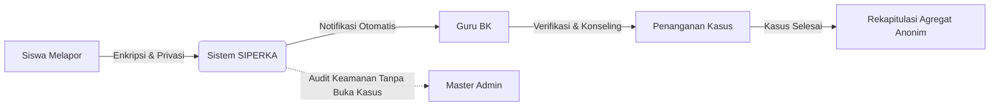
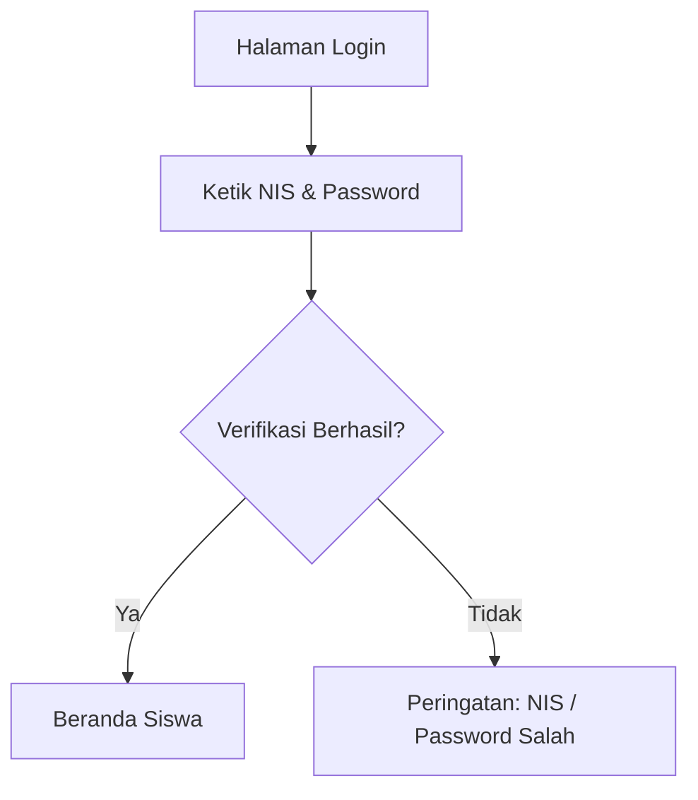
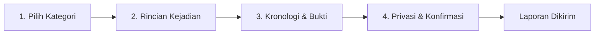
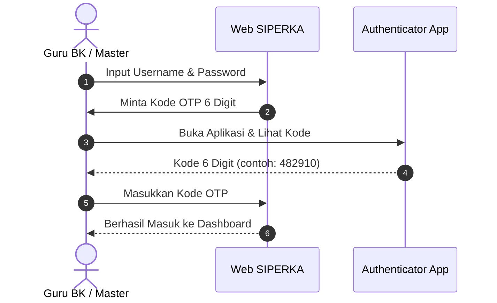

# BUKU PANDUAN PENGGUNAAN SISTEM INFORMASI SIPERKA
## *Sistem Pelaporan Perundungan Terpadu & Terpercaya*
### **Madrasah Tsanawiyah (MTs) Soebono Mantofani**

---

```
================================================================================
                           BUKU MANUAL RESMI SISTEM
                       PANDUAN OPERASIONAL PENGGUNA
                        EDISI TAHUN AJARAN 2026/2027
================================================================================
Nama Aplikasi     : SIPERKA (Sistem Pelaporan Perundungan)
Institusi         : MTs Soebono Mantofani, Jombang - Ciputat, Tangerang Selatan
Landasan Hukum    : Permendikbudristek No. 46 Tahun 2023
Sasaran Pembaca   : Peserta Didik (Siswa), Guru BK (Konselor), Master Administrator
================================================================================
```

---

## DAFTAR ISI

- [KATA PENGANTAR](#kata-pengantar)
- [BAGIAN I: PENGENALAN & LANDASAN SIPERKA](#bagian-i-pengenalan--landasan-siperka)
  - [Bab 1: Mengenal SIPERKA](#bab-1-mengenal-siperka)
  - [Bab 2: Landasan Hukum & Kebijakan Perlindungan Anak](#bab-2-landasan-hukum--kebijakan-perlindungan-anak)
  - [Bab 3: Arsitektur Keamanan & Matriks Hak Akses](#bab-3-arsitektur-keamanan--matriks-hak-akses)
- [BAGIAN II: PANDUAN PENGGUNA UNTUK SISWA](#bagian-ii-panduan-pengguna-untuk-siswa)
  - [Bab 4: Akses & Masuk ke Portal Siswa](#bab-4-akses--masuk-ke-portal-siswa)
  - [Bab 5: Alur Membuat Laporan Perundungan (Formulir 4 Tahap)](#bab-5-alur-membuat-laporan-perundungan-formulir-4-tahap)
  - [Bab 6: Memantau Status Laporan & Berkomunikasi dengan Guru BK](#bab-6-memantau-status-laporan--berkomunikasi-dengan-guru-bk)
  - [Bab 7: Layanan Bantuan Darurat & Hotline Nasional](#bab-7-layanan-bantuan-darurat--hotline-nasional)
- [BAGIAN III: PANDUAN PENGGUNA UNTUK GURU BK](#bagian-iii-panduan-pengguna-untuk-guru-bk)
  - [Bab 8: Dashboard Konselor & Indikator Laporan Masuk](#bab-8-dashboard-konselor--indikator-laporan-masuk)
  - [Bab 9: Verifikasi, Kronologi Kejadian & Klasifikasi Urgensi](#bab-9-verifikasi-kronologi-kejadian--klasifikasi-urgensi)
  - [Bab 10: Obrolan Dua Arah Resmi & Catatan Internal Rahasia](#bab-10-obrolan-dua-arah-resmi--catatan-internal-rahasia)
  - [Bab 11: Penetapan Tindak Lanjut & Penutupan Kasus](#bab-11-penetapan-tindak-lanjut--penutupan-kasus)
  - [Bab 12: Manajemen Kategori, Analisis Statistik & Rekapitulasi](#bab-12-manajemen-kategori-analisis-statistik--rekapitulasi)
- [BAGIAN IV: PANDUAN PENGGUNA UNTUK MASTER ADMIN](#bagian-iv-panduan-pengguna-untuk-master-admin)
  - [Bab 13: Dashboard Eksekutif & Konfigurasi Beranda Madrasah](#bab-13-dashboard-eksekutif--konfigurasi-beranda-madrasah)
  - [Bab 14: Tata Kelola Akun Siswa & Guru BK](#bab-14-tata-kelola-akun-siswa--guru-bk)
  - [Bab 15: Impor Data Massal Siswa via Berkas Excel](#bab-15-impor-data-massal-siswa-via-berkas-excel)
  - [Bab 16: Kenaikan Kelas & Pengarsipan Alumni (Soft-Delete)](#bab-16-kenaikan-kelas--pengarsipan-alumni-soft-delete)
  - [Bab 17: Log Audit Aktivitas Keamanan & Retensi Data](#bab-17-log-audit-aktivitas-keamanan--retensi-data)
- [BAGIAN V: KEAMANAN & AUTENTIKASI DUA FAKTOR (2FA)](#bagian-v-keamanan--autentikasi-dua-faktor-2fa)
  - [Bab 18: Panduan Autentikasi Dua Faktor (2FA TOTP) untuk Staf](#bab-18-panduan-autentikasi-dua-faktor-2fa-totp-untuk-staf)
- [BAGIAN VI: TANYA JAWAB (FAQ) & TROUBLESHOOTING](#bagian-vi-tanya-jawab-faq--troubleshooting)
  - [Bab 19: Tanya Jawab Siswa](#bab-19-tanya-jawab-siswa)
  - [Bab 20: Tanya Jawab Guru BK & Administrator](#bab-20-tanya-jawab-guru-bk--administrator)
- [GLOSARIUM ISTILAH](#glosarium-istilah)
- [LEMBAR PENUTUP & KONTAK DUKUNGAN](#lembar-penutup--kontak-dukungan)

---

## KATA PENGANTAR

*Assalamu’alaikum Warahmatullahi Wabarakatuh,*

Puji dan syukur kita panjatkan ke hadirat Allah SWT atas limpahan rahmat dan karunia-Nya, sehingga **Buku Panduan Penggunaan Sistem Informasi SIPERKA (Sistem Pelaporan Perundungan)** di lingkungan MTs Soebono Mantofani dapat diselesaikan dengan baik.

Madrasah Tsanawiyah Soebono Mantofani memiliki komitmen yang teguh untuk mewujudkan iklim pendidikan yang aman, inklusif, ramah anak, dan bebas dari segala bentuk intimidasi maupun perundungan (*zero-tolerance to bullying*). Keberadaan SIPERKA merupakan wujud nyata transformasi digital madrasah dalam merespons amanat **Permendikbudristek Nomor 46 Tahun 2023 tentang Pencegahan dan Penanganan Kekerasan di Lingkungan Satuan Pendidikan**.

Sistem ini didesain dengan menjunjung tinggi nilai kerahasiaan, empati, dan keadilan. Siswa yang menjadi korban maupun saksi perundungan kini memiliki saluran terenkripsi yang aman untuk bercerita tanpa rasa cemas akan ancaman atau pengungkapan identitas yang tidak diinginkan. Di sisi lain, Guru Bimbingan dan Konseling (BK) memiliki instrumen terintegrasi untuk melakukan verifikasi bukti, pendampingan psikososial, dan dokumentasi penanganan secara profesional.

Buku manual ini disusun sebagai pedoman resmi operasional sistem bagi seluruh pemangku kepentingan. Kami mengimbau seluruh dewan guru, staf konselor, administrator, serta peserta didik untuk membaca, memahami, dan memedomani buku ini dengan sebaik-baiknya.

Semoga kehadiran SIPERKA senantiasa membawa kemaslahatan, melindungi martabat anak bangsa, dan menjadikan madrasah kita sebagai tempat menuntut ilmu yang menyejukkan hati.

*Wassalamu’alaikum Warahmatullahi Wabarakatuh.*

Tangerang Selatan, November 2026  
**Tim Pengembang & Manajemen MTs Soebono Mantofani**

---

# BAGIAN I: PENGENALAN & LANDASAN SIPERKA

## Bab 1: Mengenal SIPERKA

### 1.1 Apa Itu SIPERKA?
**SIPERKA** (*Sistem Pelaporan Perundungan MTs Soebono Mantofani*) adalah platform aplikasi berbasis web resmi yang didedikasikan sebagai media pelaporan, penanganan kasus, dan pendampingan konseling bagi peserta didik madrasah yang mengalami atau menyaksikan tindak perundungan (*bullying*).

### 1.2 Filosofi & Desain Sistem
Nama SIPERKA dirancang dengan nilai filosofis:
* **Suara Aman (*Safe Voice*)**: Menjadi jembatan bagi peserta didik untuk bersuara secara rahasia tanpa takut dihakimi atau diancam.
* **Tindakan Cepat (*Swift Action*)**: Menyajikan antarmuka notifikasi terpadu agar Guru BK dapat memberikan respons dalam batas waktu standar (maksimal 1x24 jam kerja).
* **Tertata & Adil (*Accountable & Fair*)**: Setiap catatan kronologi, perubahan status, dan intervensi konseling tercatat secara sistematis dalam rekam jejak digital tanpa merusak privasi siswa.



---

## Bab 2: Landasan Hukum & Kebijakan Perlindungan Anak

SIPERKA dibangun dengan landasan hukum yang kuat:
1. **Permendikbudristek No. 46 Tahun 2023** tentang Pencegahan dan Penanganan Kekerasan di Satuan Pendidikan (PPKSP).
2. **Undang-Undang No. 35 Tahun 2014 tentang Perlindungan Anak**: Pasal 54 menegaskan bahwa anak di dalam dan di lingkungan satuan pendidikan wajib mendapatkan perlindungan dari tindak kekerasan fisik, psikis, maupun kejahatan seksual.
3. **Keputusan Direktur Jenderal Pendidikan Islam Kementerian Agama RI** tentang Pedoman Madrasah Ramah Anak.

> [!IMPORTANT]
> **Kebijakan Nol-Toleransi (*Zero-Tolerance Policy*)**:
> Segala bentuk kekerasan fisik, verbal, sosial, maupun daring (*cyberbullying*) di lingkungan MTs Soebono Mantofani akan ditindaklanjuti secara mendidik dan proporsional demi memulihkan kondisi psikologis korban dan membimbing pelaku agar menyadari kesalahannya.

---

## Bab 3: Arsitektur Keamanan & Matriks Hak Akses

Untuk menjamin asas kerahasiaan (*confidentiality*), sistem membagi peran ke dalam tiga tingkat wewenang (*Role-Based Access Control* / RBAC):

### 3.1 Matriks Hak Akses Antar Peran

| Fitur / Halaman | Siswa | Guru BK | Master Admin |
|---|:---:|:---:|:---:|
| **Membuat Laporan Baru** | ✅ Ya | ❌ Tidak | ❌ Tidak |
| **Melihat Detail Kasus & Kronologi** | ✅ Hanya Milik Sendiri | ✅ Seluruh Laporan | ❌ **DIBLOKIR TOTAL** |
| **Melihat Lampiran Bukti Foto** | ✅ Hanya Milik Sendiri | ✅ Seluruh Laporan | ❌ **DIBLOKIR TOTAL** |
| **Kirim Pesan Obrolan Konseling** | ✅ Pada Laporannya | ✅ Pada Laporannya | ❌ **DIBLOKIR TOTAL** |
| **Membuat Catatan Internal BK** | ❌ Tidak | ✅ Ya (Rahasia) | ❌ **DIBLOKIR TOTAL** |
| **Mengubah Status & Urgensi Kasus** | ❌ Tidak | ✅ Ya | ❌ Tidak |
| **Kelola Kategori Perundungan** | ❌ Tidak | ✅ Ya | ❌ Tidak |
| **Unduh Berkas Rekap (PDF/Excel)** | ❌ Tidak | ✅ Ya | ❌ Tidak |
| **Kelola Akun Pengguna (Siswa/BK)** | ❌ Tidak | ❌ Tidak | ✅ Ya |
| **Impor Massal Siswa via Excel** | ❌ Tidak | ❌ Tidak | ✅ Ya |
| **Kenaikan Kelas & Kelulusan Alumni** | ❌ Tidak | ❌ Tidak | ✅ Ya |
| **Melihat Log Audit Aktivitas** | ❌ Tidak | ❌ Tidak | ✅ Ya |
| **Pengaturan Identitas Madrasah** | ❌ Tidak | ❌ Tidak | ✅ Ya |

> [!CAUTION]
> **Pemisahan Wewenang (*Separation of Concerns*)**:
> Master Administrator adalah administrator teknis. Master Admin **TIDAK MEMILIKI HAK AKSES** untuk membaca isi laporan, membuka bukti foto, membaca obrolan konseling, maupun melihat nama terlapor. Hal ini menjamin privasi siswa tidak dapat diintip oleh siapapun di luar Guru BK yang berwenang.

---

# BAGIAN II: PANDUAN PENGGUNA UNTUK SISWA

## Bab 4: Akses & Masuk ke Portal Siswa

### 4.1 Membuka Halaman Masuk
1. Buka peramban (*Google Chrome / Mozilla Firefox / Safari*) pada ponsel atau komputer.
2. Akses alamat web SIPERKA madrasah: `https://siperka.mts-soebonomantofani.sch.id` (atau tautan resmi yang dibagikan madrasah).
3. Di sudut kanan atas halaman utama, tekan tombol **Masuk**.

### 4.2 Masuk Menggunakan Akun Siswa
* **ID Pengguna / Username**: Gunakan **Nomor Induk Siswa (NIS)** Anda (contoh: `20261001`).
* **Kata Sandi**: Masukkan kata sandi akun Anda (kata sandi default awal yang dibagikan wali kelas: `SiswaMTS!`).
* Tekan tombol **Masuk ke Portal**.



---

## Bab 5: Alur Membuat Laporan Perundungan (Formulir 4 Tahap)

SIPERKA menyediakan formulir pelaporan terpadu (*Wizard*) yang membimbing siswa langkah demi langkah agar tidak bingung.



### Langkah 1: Memilih Kategori Perundungan
* Buka menu **Buat Laporan** pada navigasi sidebar.
* Pilih jenis kejadian yang kamu alami atau saksikan:
  - **Perundungan Fisik**: Pemukulan, dorongan, penendangan, atau perusakan barang.
  - **Perundungan Verbal**: Hinaan, ejekan nama orang tua, kata-kata kasar, pemalakan uang.
  - **Perundungan Sosial / Relasional**: Pengucilan sengaja, penyebaran rumor bohong, penghasutan.
  - **Perundungan Siber (*Cyberbullying*)**: Teror di WhatsApp/Instagram, penyebaran foto tanpa izin, komentar jahat di media sosial.
* Tekan **Lanjut ke Tahap 2**.

### Langkah 2: Mengisi Rincian Waktu & Lokasi
* **Pihak yang Terlapor**: Ketikkan nama atau ciri-ciri pelaku (bisa dikosongkan bila tidak tahu namanya).
* **Tanggal & Waktu Kejadian**: Pilih tanggal saat peristiwa itu berlangsung.
* **Tempat / Lokasi Kejadian**: Pilih atau ketikkan tempat kejadian (contoh: *Kantin Belakang, Lorong Kelas 8, Lapangan Futsal, Grup Obrolan WA*).
* **Peran Pelapor**: Tentukan apakah kamu melapor sebagai **Korban Langsung** atau sebagai **Saksi Teman**.
* Tekan **Lanjut ke Tahap 3**.

### Langkah 3: Menuliskan Kronologi Lengkap & Unggah Bukti
* **Penjelasan Kronologi**: Tuliskan apa yang terjadi dengan jujur, tenang, dan runtut. Ceritakan apa yang kamu lihat, dengar, dan rasakan (minimal 10 karakter).
* **Lampiran Bukti Foto (Opsional)**:
  - Kamu dapat melampirkan tangkapan layar (*screenshot chat*), foto memar/kerusakan barang, atau berkas pendukung (format JPG, PNG, atau PDF maksimal 5MB).
  - Jika tidak ada foto bukti, langkah ini boleh dilewati.
* Tekan **Lanjut ke Tahap 4**.

### Langkah 4: Pengaturan Privasi & Konfirmasi Akhir
* **Pilihan Kerahasiaan Identitas**:
  - **Sembunyikan Identitas Saya (Pelapor Rahasia/Anonim)**: Nama dan NIS kamu akan disamarkan sebagai *"Pelapor Rahasia"*. Guru BK sekalipun tidak akan melihat namamu di awal laporan, sehingga kamu bisa bercerita dengan rasa aman 100%.
  - **Tampilkan Nama Saya**: Nama kamu akan tampil resmi kepada Guru BK agar konseling tatap muka bisa diatur lebih cepat.
* **Periksa Ringkasan Laporan**: Baca kembali ringkasan laporan sebelum dikirim.
* Tekan tombol **Kirim Laporan Resmi**.

> [!TIP]
> Setelah berhasil mengirim, sistem akan menampilkan notifikasi sukses dan memberikan **Nomor Tiket Kasus** resmi (contoh: `#LAP-0012`). Simpan nomor tiket ini untuk memantau kasusmu.

---

## Bab 6: Memantau Status Laporan & Berkomunikasi dengan Guru BK

### 6.1 Memahami Status Laporan

| Label Status | Arti & Maknanya |
|---|---|
| **Diterima (Baru)** | Laporan telah masuk ke antrean Guru BK dan menunggu dibaca. |
| **Diverifikasi** | Guru BK telah membaca laporan dan sedang memverifikasi fakta awal. |
| **Dalam Penanganan** | Guru BK sedang melakukan pemanggilan, konseling, atau mediasi. |
| **Selesai** | Penanganan masalah telah tuntas dan disepakati oleh semua pihak. |
| **Ditolak** | Laporan tidak dapat diproses (disertai alasan jelas dari Guru BK). |

### 6.2 Ruang Obrolan Dua Arah Resmi
1. Buka menu **Laporan Saya**, lalu klik kartu laporan yang ingin dilihat.
2. Di bagian bawah detail laporan, terdapat panel **Ruang Percakapan & Keterangan Susulan**.
3. Siswa dapat membaca pesan arahan atau jadwal pemanggilan dari Guru BK.
4. Siswa dapat membalas pesan, mengabarkan kondisi terkini, atau memberikan keterangan tambahan secara langsung tanpa perlu malu.

---

## Bab 7: Layanan Bantuan Darurat & Hotline Nasional

Jika kamu sedang berada dalam bahaya mendesak atau membutuhkan bantuan psikologis segera, buka menu **Bantuan & Kontak**:
* **Ruang Konseling BK MTs Soebono Mantofani**: Terletak di Gedung Utama Lt. 2 (Buka Senin–Jumat 07.30–15.00 WIB).
* **Layanan SAPA 129 (KemenPPPA)**: Hotline telepon darurat bebas pulsa 129 atau WhatsApp 08111-129-129.
* **Layanan Pengaduan KPAI**: Perlindungan hak anak di nomor 021-31901556.

---

# BAGIAN III: PANDUAN PENGGUNA UNTUK GURU BK

## Bab 8: Dashboard Konselor & Indikator Laporan Masuk

Setelah login menggunakan NIP/Username, Guru BK akan disambut oleh Dashboard Konselor:
1. **Kartu Indikator KPI Utama**:
   - *Total Laporan*: Seluruh kasus yang pernah masuk.
   - *Laporan Perlu Tindak Lanjut*: Kasus berstatus baru yang belum dibaca dalam 1x24 jam kerja.
   - *Kasus Sedang Ditangani*: Kasus aktif dalam tahap mediasi/pendampingan.
   - *Kasus Terselesaikan*: Rekapitulasi kasus yang berhasil diselesaikan.
2. **Widget Kasus Berurgensi Tinggi**: Laporan dengan tingkat urgensi tinggi (*urgent*) ditempatkan di bagian paling atas dengan penanda berkedip merah agar segera direspons.

---

## Bab 9: Verifikasi, Kronologi Kejadian & Klasifikasi Urgensi

### 9.1 Membaca Detail Laporan
1. Masuk ke menu **Laporan Masuk** di sidebar.
2. Gunakan **Segmented Filter Tab** (*Semua, Diterima, Diverifikasi, Dalam Penanganan, Selesai, Ditolak*) untuk menyaring antrean.
3. Klik salah satu baris laporan untuk membuka halaman detail.

### 9.2 Menilai Urgensi & Bukti
* **Penjelasan Kronologi**: Teks tersusun rapi dengan format rata kanan-kiri (*justified*) sehingga narasi panjang mudah dibaca.
* **Lampiran Bukti**: Tekan tombol **Buka** pada berkas lampiran untuk melihat foto atau tangkapan layar pendukung di tab baru.
* **Tingkat Urgensi**:
  - **Tinggi**: Ancaman kekerasan fisik aktif, cedera tubuh, pemerasan bersenjata, atau trauma depresi berat.
  - **Sedang**: Intimidasi verbal berulang, pengucilan sosial di kelas, atau perundungan siber berkelanjutan.
  - **Rendah**: Perselisihan ejekan ringan spontan yang dapat diselesaikan dengan teguran ramah.

### 9.3 Prosedur Pembukaan Identitas Pelapor Rahasia
Bila pelapor memilih mode rahasia, identitasnya akan tertulis sebagai **Pelapor Rahasia (Anonim)**.
* Jika kasus berada pada tahap kritis dan penyelamatan siswa membutuhkan identitas aslinya, tekan tombol **Buka Identitas Pelapor**.
* Sistem akan memunculkan dialog peringatan bahwa aksi ini akan **dicatat ke dalam Log Audit Keamanan**.
* Setelah dikonfirmasi, nama asli siswa, NIS, dan rombel kelas akan terbuka untuk Guru BK.

---

## Bab 10: Obrolan Dua Arah Resmi & Catatan Internal Rahasia

### 10.1 Komunikasi Resmi dengan Siswa
* Terletak di kartu **Komunikasi Resmi dengan Siswa Pelapor**.
* Terdapat badge status **Saluran Aktif** dan counter **Pesan**.
* Guru BK dapat memanfaatkan fitur **Template Respon Cepat Konselor**:
  - 💬 *Konfirmasi Diterima & Ditenangkan*
  - 📅 *Undangan ke Ruang BK*
  - 🔍 *Permintaan Keterangan Tambahan*
  - ✅ *Pemantauan Pasca-Penanganan*
* Ketik pesan pada kolom input lalu klik **Kirim Balasan Resmi**. Siswa akan langsung menerima pemberitahuan di lonceng notifikasi dan portal siswa.

### 10.2 Catatan Internal Guru BK (*Kerahasiaan Tertinggi*)
* Kartu ini berwarna aksen amber/emas khusus.
* Digunakan untuk mencatat jalannya pemanggilan orang tua, berita acara mediasi antarsiswa, atau catatan observasi psikologis.
* **PENTING**: Catatan internal **TIDAK BISA DIBACA OLEH SISWA MAUPUN MASTER ADMIN**. Hanya akun Guru BK yang dapat membaca dan menambah catatan ini.

---

## Bab 11: Penetapan Tindak Lanjut & Penutupan Kasus

1. Pada kolom kanan, temukan kartu **Tindak Lanjut Kasus**.
2. Pilih status baru pada dropdown **Perbarui Status**:
   - Pilih *Sudah dibaca (Diverifikasi)* saat pemeriksaan awal berkas selesai.
   - Pilih *Sedang ditangani (Diproses)* selama sesi konseling/mediasi berjalan.
   - Pilih *Selesai* saat kedua pihak telah berdamai dan penanganan dinyatakan tuntas.
   - Pilih *Tidak dapat diproses (Ditolak)* jika laporan merupakan informasi keliru/palsu (wajib menyertakan alasan edukatif yang sopan).
3. Klik tombol **Perbarui Status Laporan**.
4. **Penguncian Otomatis**: Jika laporan telah ditandai **Selesai**, sistem akan mengunci formulir secara permanen untuk mencegah manipulasi data historis di masa mendatang.

---

## Bab 12: Manajemen Kategori, Analisis Statistik & Rekapitulasi

### 12.1 Kelola Kategori Kasus
* Buka menu **Kelola Kategori** di bawah menu laporan.
* Guru BK dapat menambah jenis kategori baru atau memperbarui deskripsi panduan kategori sesuai dinamika madrasah.

### 12.2 Analisis Statistik Interaktif
* Buka menu **Statistik**.
* Memuat visualisasi grafik batang (*Chart.js*) mengenai:
  - Tren laporan bulanan sepanjang tahun ajaran.
  - Distribusi kasus per kategori perundungan.
  - Persebaran lokasi rawan kejadian di madrasah.
  - Statistik agregat per tingkat kelas.

### 12.3 Mengunduh Rekapitulasi Laporan
* Buka menu **Unduh Laporan**.
* Tentukan filter rentang tanggal, status, atau kategori kasus.
* Pilih format berkas yang diinginkan:
  - **Dokumen PDF Resmi**: Berkas PDF tertata rapi siap cetak lengkap dengan kop surat MTs Soebono Mantofani dan tabel kasus.
  - **Berkas Excel Spreadsheet**: Berkas `.xlsx` yang siap diolah untuk presentasi evaluasi kepala madrasah atau pengawas Kemenag.

---

# BAGIAN IV: PANDUAN PENGGUNA UNTUK MASTER ADMIN

## Bab 13: Dashboard Eksekutif & Konfigurasi Beranda Madrasah

Master Admin memegang kendali atas infrastruktur dan tata kelola akun madrasah:
1. **Navigasi Sidebar Semantik**:
   - `Kelola Akun`: Data Siswa & Guru BK.
   - `Akademik & Kelas`: Data Rombel Kelas & Tahun Ajaran Aktif.
   - `Sistem & Konfigurasi`: Log Audit Aktivitas, Pengaturan Web, dan Evaluasi Retensi.
2. **Pengaturan Identitas Madrasah**:
   - Mengubah nama sekolah, alamat, nomor telepon, email resmi, dan teks sambutan kepala madrasah pada menu **Pengaturan Web**.

---

## Bab 14: Tata Kelola Akun Siswa & Guru BK

### 14.1 Pembuatan Akun Manual
1. Masuk ke menu **Data Siswa** atau **Data Guru BK**.
2. Klik tombol **Tambah Siswa** / **Tambah Guru BK**.
3. Isi data wajib: NIS/NIP, Nama Lengkap, Kelas (untuk siswa), dan Kata Sandi awal.
4. Klik **Simpan Akun**.
5. Sistem akan menampilkan notifikasi toast **SweetAlert2** dan mengosongkan formulir secara otomatis (*auto-reset*) sehingga admin dapat langsung menginput siswa berikutnya dengan efisien.

### 14.2 Mengatur Ulang Kata Sandi (*Reset Password*) Siswa
Jika seorang siswa lupa kata sandinya:
1. Cari akun siswa menggunakan kolom pencarian (ketik NIS atau Nama).
2. Klik tombol opsi aksi &rarr; **Reset Password**.
3. Konfirmasi dialog SweetAlert2.
4. Kata sandi siswa akan dikembalikan ke standar awal (`SiswaMTS!`) dan siswa dapat langsung login kembali.

---

## Bab 15: Impor Data Massal Siswa via Berkas Excel

Untuk memasukkan ratusan data siswa baru di awal tahun ajaran secara cepat:
1. Buka menu **Data Siswa** &rarr; klik tombol **Impor Excel**.
2. Unduh **Template Resmi Excel (.xlsx)** yang telah disediakan sistem.
3. Buka berkas template dan isi kolom data:
   - `nis`: Nomor Induk Siswa (wajib unik).
   - `nama`: Nama lengkap siswa.
   - `kelas`: Nama rombel kelas yang sudah terdaftar di sistem (contoh: `7-A`, `8-B`).
   - `jenis_kelamin`: `L` atau `P`.
4. Unggah berkas Excel ke area dropzone yang tersedia.
5. Sistem akan melakukan **Validasi Baris Otomatis**:
   - Jika ada baris yang NIS-nya kembar atau kelasnya tidak ditemukan, baris tersebut akan ditandai merah beserta pesan kesalahannya.
6. Klik **Konfirmasi & Simpan Seluruh Siswa**. Sistem memproses ribuan data siswa dalam waktu kurang dari 2 detik menggunakan optimasi *Bulk Insert*.

---

## Bab 16: Kenaikan Kelas & Pengarsipan Alumni (Soft-Delete)

Pada pergantian tahun ajaran, Master Admin menjalankan menu **Operasi Kelas**:
* **Kenaikan Kelas Tahunan**:
  - Menaikkan seluruh siswa dari kelas 7 ke kelas 8, dan kelas 8 ke kelas 9 secara kolektif dengan satu kali klik.
* **Pengarsipan Massal Siswa Alumni (Kelas 9 Lulus)**:
  - Siswa yang telah lulus diarsipkan secara massal.
  - **Prinsip Soft-Delete**: Akun siswa alumni dinonaktifkan dari akses login, **TETAPI seluruh riwayat laporan perundungan terdahulu tetap tersimpan utuh di database madrasah**. Hal ini menjamin rekam jejak madrasah tidak pernah hilang untuk audit hukum.

---

## Bab 17: Log Audit Aktivitas Keamanan & Retensi Data

### 17.1 Memantau Log Aktivitas
* Buka menu **Log Aktivitas** di sidebar.
* Setiap aktivitas genting terekam secara otomatis:
  - Percobaan login staf dan pergantian kata sandi.
  - Aksi pembukaan identitas pelapor anonim oleh Guru BK.
  - Aksi impor massal, penambahan akun, atau penghapusan data.
  - Dilengkapi alamat IP pengakses, tanggal, jam, dan peramban yang digunakan.

### 17.2 Kebijakan Retensi Data
* Buka menu **Evaluasi Retensi**.
* Sistem menjalankan evaluasi kepatuhan data laporan yang telah melampaui batas retensi (misal: 3 tahun atau 5 tahun pasca-penyelesaian) untuk memastikan madrasah tidak menyimpan data usang tanpa dasar legal.

---

# BAGIAN V: KEAMANAN & AUTENTIKASI DUA FAKTOR (2FA)

## Bab 18: Panduan Autentikasi Dua Faktor (2FA TOTP) untuk Staf

Untuk melindungi kerahasiaan data anak, akun Guru BK dan Master Admin dilengkapi perlindungan lapis ganda: **Autentikasi Dua Faktor berbasis Waktu (*Time-based One-Time Password* / TOTP)**.



### 18.1 Langkah Mengaktifkan 2FA
1. Masuk ke menu **Profil Saya** &rarr; scroll ke bagian **Autentikasi Dua Faktor (2FA)**.
2. Klik tombol **Aktifkan Autentikasi Dua Faktor**.
3. Buka aplikasi authenticator di ponsel Anda (*Google Authenticator / Microsoft Authenticator / 2FAS*).
4. Pindai (*scan*) **Kode QR** yang muncul di layar laptop.
5. Masukkan 6 digit angka yang muncul di ponsel ke dalam form konfirmasi SIPERKA, lalu klik **Verifikasi & Aktifkan**.

### 18.2 Menyimpan Kode Pemulihan Darurat (*Recovery Codes*)
* Saat 2FA aktif, sistem akan memberikan **8 Kode Pemulihan Darurat** (berisi 10 karakter alfanumerik acak).
* **UNDUH ATAU CETAK KODE INI DAN SIMPAN DI TEMPAT AMAN**.
* Jika suatu saat ponsel Anda hilang, rusak, atau kehabisan baterai, gunakan salah satu kode pemulihan ini sebagai pengganti OTP untuk tetap bisa masuk ke sistem.

---

# BAGIAN VI: TANYA JAWAB (FAQ) & TROUBLESHOOTING

## Bab 19: Tanya Jawab Siswa

**T: Apakah teman-teman saya bisa tahu kalau saya membuat laporan?**  
*J: Tidak. Laporanmu 100% rahasia dan hanya dapat diakses oleh tim Guru BK. Teman sekelas, ketua kelas, bahkan wali kelasmu tidak memiliki akses ke sistem SIPERKA.*

**T: Bagaimana jika saya takut ketahuan oleh pelaku?**  
*J: Pilihlah opsi **"Sembunyikan Identitas Saya (Pelapor Rahasia)"** di Tahap 4 formulir. Nama dan NIS kamu tidak akan dicantumkan di laporan.*

**T: Saya tidak punya bukti foto atau video, apakah tetap boleh melapor?**  
*J: Tentu saja sangat boleh. Bukti foto bersifat opsional. Ceritakan saja kronologi yang kamu alami secara jujur dan jelas.*

**T: Saya lupa kata sandi akun siswa saya, apa yang harus saya lakukan?**  
*J: Hubungi wali kelasmu atau Guru BK untuk meminta bantuan reset kata sandi ke Master Admin madrasah.*

---

## Bab 20: Tanya Jawab Guru BK & Administrator

**T: Mengapa tombol pada formulir Tindak Lanjut Kasus tidak bisa diedit lagi?**  
*J: Kasus yang telah berstatus **Selesai** akan dikunci secara otomatis oleh sistem demi menjaga integritas data hukum. Jika ada insiden baru yang melibatkan siswa yang sama di kemudian hari, buatlah laporan tiket baru.*

**T: Mengapa Master Admin tidak menerima notifikasi laporan perundungan baru?**  
*J: Berdasarkan asas privasi Permendikbudristek No. 46/2023, Master Admin hanya mengurus infrastruktur teknis. Urusan notifikasi insiden siswa sepenuhnya menjadi hak eksklusif Guru BK dan Siswa terkait.*

**T: Apa yang terjadi jika file Excel impor gagal diunggah?**  
*J: Pastikan format file adalah `.xlsx`. Periksa pratinjau verifikasi baris di layar untuk melihat nomor baris mana yang error (misal: NIS duplikat atau nama rombel kelas belum terdaftar).*

---

## GLOSARIUM ISTILAH

* **SIPERKA**: Sistem Pelaporan Perundungan MTs Soebono Mantofani.
* **Anonim / Pelapor Rahasia**: Fitur penyamaran identitas pelapor untuk menjamin keselamatan dan kenyamanan siswa saat mengadukan kasus.
* **Guru BK**: Guru Bimbingan dan Konseling yang bertindak sebagai konselor resmi madrasah.
* **Master Admin**: Administrator pengelola akun, kelas, dan konfigurasi teknis sistem madrasah.
* **Urgensi**: Klasifikasi tingkat kegentingan penanganan kasus (*Tinggi, Sedang, Rendah*).
* **Catatan Internal**: Notula rahasia yang hanya dapat dibaca oleh sesama Guru BK.
* **2FA (Two-Factor Authentication)**: Lapisan keamanan kedua berbasis kode waktu 6 digit untuk melindungi akun staf.
* **Soft-Delete**: Metode penghapusan aman di mana data alumni tidak dihapus permanen dari basis data fisik demi arsip hukum.
* **IDOR (Insecure Direct Object Reference)**: Celah keamanan di mana pengguna mencoba mengakses data milik orang lain; SIPERKA telah diproteksi 100% dari celah ini.

---

## LEMBAR PENUTUP & KONTAK DUKUNGAN

Buku panduan ini merupakan dokumen resmi madrasah. Seluruh informasi teknis di dalamnya disesuaikan dengan versi pembaruan aplikasi SIPERKA tahun 2026.

Apabila menemukan kendala sistem atau membutuhkan asistensi lebih lanjut, silakan menghubungi:

* **Sekretariat MTs Soebono Mantofani**:  
  Jl. Bakti No. 1, Jombang - Ciputat, Tangerang Selatan, Banten 15414  
  Telepon: (021) 745-XXXX | Email: `info@mts-soebonomantofani.sch.id`
* **Ruang Layanan Bimbingan & Konseling (BK)**:  
  Gedung Utama Lantai 2, Kampus MTs Soebono Mantofani  
  Hotline Konseling Madrasah: `bk@mts-soebonomantofani.sch.id`

---
*SIPERKA MTs Soebono Mantofani &mdash; Bersama Mewujudkan Madrasah Aman, Nyaman, dan Beradab.*
